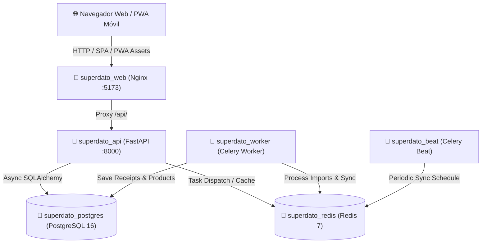

# SuperDato 🛒📊

[](docker-compose.yml)
[](https://fastapi.tiangolo.com)
[](https://react.dev)
[](https://www.typescriptlang.org)
[](https://www.postgresql.org)
[](frontend/public/manifest.webmanifest)
[](LICENSE)

**SuperDato** es una plataforma web modular, autónoma y auto-alojable (*self-hosted*) para importar, organizar, auditar y analizar los tickets de compra digitales y en papel de **Mercadona**.

Permite a familias, pisos compartidos y usuarios particulares monitorizar el gasto mensual del hogar, conciliar el desglose de IVA con precisión contable, comparar la evolución histórica de precios y disponer de un asistente de lista de la compra inteligente en el supermercado mediante una aplicación web progresiva (PWA).

---

## ✨ Características Principales

- 📥 **Sincronización Automática con Gmail**: Conexión nativa con Google OAuth 2.0 que busca y descarga periódicamente tus tickets oficiales de Mercadona (`from:mercadona.es`).
- 🧾 **Asistente de Tickets Manuales**: Añade compras artículo por artículo con búsqueda predictiva y cálculo en tiempo real de importes, base imponible e IVA para compras físicas.
- 🧮 **Conciliación Contable Estricta**: Verificación matemática exacta (0,00 € de discrepancia) entre líneas de artículos, base imponible, cuotas de IVA (4%, 10%, 21%) y total del ticket.
- 📈 **Control de Inflación y Precios**: Detección automática de subidas y bajadas de precio por producto con historial temporal y variaciones porcentuales.
- 🏬 **Catálogo Normalizado con Mercadona Online**: Enriquecimiento automático de artículos con fotos oficiales en alta resolución, marcas (Hacendado, Bosque Verde, etc.) y formato de envase mediante integración con la tienda online.
- 🛡️ **Aislamiento Multi-Hogar y Seguridad**: Control de acceso granular RBAC (*Owner*, *Admin*, *Member*), cifrado simétrico AES-128-CBC + HMAC-SHA256 para tokens OAuth y contraseñas con Argon2id.
- 📱 **PWA Móvil Offline**: Instalable en iPhone y Android con Service Worker optimizado para modo supermercado en zonas sin cobertura.
- ⚙️ **Panel de Superadministración Integrado**: Gestión visual de usuarios, hogares, tokens de registro cerrado y configuración de Google OAuth en 1 clic.

---

## 🚀 Despliegue Rápido con Docker (Zero-Configuration)

El proyecto está diseñado para arrancar inmediatamente con un solo comando sin requerir configuraciones complejas ni edición obligatoria de variables de entorno:

### 1. Clonar el repositorio
```bash
git clone https://github.com/tu-usuario/SuperDato-MercadonaTicketTracker.git
cd SuperDato-MercadonaTicketTracker
```

### 2. Levantar los contenedores (¡Listo para usar!)
```bash
docker compose up -d
```

> [!TIP]
> **Zero-Configuración**: No necesitas crear ni editar manualmente un archivo `.env`.
> El sistema genera de forma autónoma claves criptográficas seguras (`SECRET_KEY` de 64 caracteres y `ENCRYPTION_MASTER_KEY` de 32 caracteres), las almacena en un volumen persistente compartido (`app_data`), configura la base de datos y arranca todos los contenedores en modo seguro.
> *(Opcional: si deseas personalizar puertos, contraseñas de Postgres o dominios, puedes copiar `.env.example` a `.env` y ajustarlo).*

En unos segundos tendrás todos los servicios funcionando:
- 🌐 **Aplicación Web**: [http://localhost:5173](http://localhost:5173)
- 📑 **Documentación OpenAPI / Swagger**: [http://localhost:8000/api/v1/docs](http://localhost:8000/api/v1/docs)
- 🩺 **Endpoint de Salud**: [http://localhost:8000/api/v1/health](http://localhost:8000/api/v1/health)

---

## 🔑 Acceso Inicial y Superadministrador

En el primer arranque en limpio, el sistema genera automáticamente el usuario **Superadministrador** con los datos configurados en tu archivo `.env`:

| Parámetro | Valor por Defecto |
| :--- | :--- |
| **Email** | `admin@superdato.com` |
| **Contraseña** | `SuperDatoAdmin2026!` *(o la que definas en `SUPERADMIN_PASSWORD`)* |
| **Rol** | `Superuser` (Acceso total al panel de administración en `/admin`) |
| **Token para invitar al primer miembro** | `SUPERDATO-INIT-2026` (1 único uso para registro seguro; tokens posteriores se generan en el panel de administración) |

> [!NOTE]
> Cualquier usuario que se registre como el primer usuario de una base de datos limpia obtiene automáticamente permisos de Superadministrador.

---

## ⚙️ Configuración de Google OAuth en 2 Minutos

No necesitas reiniciar los contenedores para activar la sincronización con Gmail. Puedes configurarlo directamente desde la interfaz web:

1. Inicia sesión con la cuenta de superadministrador y pulsa en **Panel de Administración** (o accede a [http://localhost:5173/admin](http://localhost:5173/admin)).
2. Entra en la pestaña **"Google OAuth & Servidor"**.
3. Revisa la **URL Pública del Servidor** (ej. `http://localhost:5173` o tu dominio público `https://superdato.midominio.com`).
4. La **URI de redireccionamiento autorizada** se calculará automáticamente (ej. `http://localhost:5173/integrations/google/callback`). Pulsa el botón **Copiar URI**.
5. Abre [Google Cloud Console](https://console.cloud.google.com/apis/credentials):
   - Habilita la **Gmail API**.
   - En *Pantalla de consentimiento OAuth*, añade el scope `https://www.googleapis.com/auth/gmail.readonly`.
   - En *Credenciales*, crea un **ID de cliente de OAuth** (tipo *Aplicación Web*) y pega la URI copiada en **URIs de redireccionamiento autorizados**.
6. Copia el **ID de cliente** y el **Secreto de cliente** y pégalos en el panel de SuperDato. Pulsa **Guardar Configuración**.
7. ¡Ya puedes vincular cualquier cuenta de Gmail desde la pestaña *Importar* de tu hogar!

---

## 💻 Desarrollo Local (Sin Docker)

Si prefieres ejecutar el proyecto directamente en tu máquina:

### Requisitos Previos
- Python 3.12 o superior.
- Node.js 20 o superior y npm.

### Backend (FastAPI)
```bash
# Crear y activar entorno virtual
python -m venv .venv

# Windows PowerShell:
.\.venv\Scripts\Activate.ps1
# Linux / macOS:
source .venv/bin/activate

# Instalar dependencias
pip install -r backend/requirements.txt

# Ejecutar tests
pytest backend/tests -v

# Arrancar backend en modo desarrollo (utiliza SQLite local automáticamente)
$env:DATABASE_URL="sqlite+aiosqlite:///./superdato_dev.db"  # Windows
export DATABASE_URL="sqlite+aiosqlite:///./superdato_dev.db" # Linux/macOS
python -m uvicorn app.main:app --app-dir backend --reload --port 8000
```

### Frontend (React + Vite)
```bash
cd frontend
npm install
npm run dev
```
La aplicación web estará disponible en [http://localhost:5173](http://localhost:5173).

---

## 🏗️ Arquitectura del Stack Docker



---

## 🔒 Privacidad y Seguridad

- **Tokens OAuth Cifrados**: Los refresh tokens de Google se cifran con Fernet (AES-128-CBC + HMAC-SHA256) antes de almacenarse en la base de datos.
- **Acceso Estricto a Gmail**: La aplicación solo solicita el permiso de lectura estricto `gmail.readonly` y filtra exclusivamente correos que contengan adjuntos PDF procedentes de `@mercadona.es`.
- **Aislamiento Multi-Tenant**: Ningún usuario u hogar puede visualizar tickets, importes o compras de otro hogar mediante comprobaciones anti-IDOR en base de datos.
- **Contraseñas Seguras**: Hasheadas mediante el algoritmo de última generación **Argon2id** con detección de fuerza bruta y bloqueo automático temporal tras 5 intentos fallidos.

---

## 📄 Licencia

Distribuido bajo la licencia **MIT**. Consulta el archivo `LICENSE` para más información.
