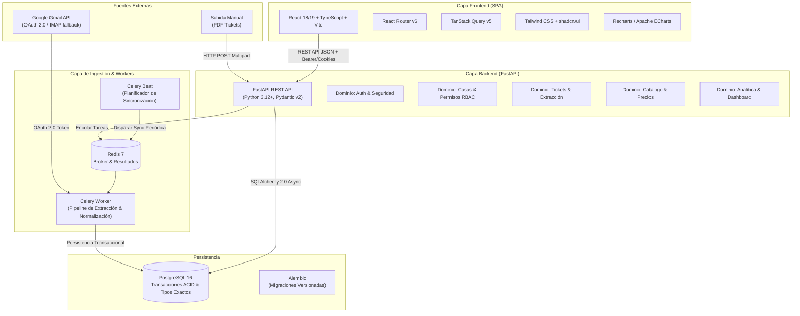

# SuperDato — 01. Arquitectura y Diseño del Sistema

## 1. Visión General del Sistema y Objetivos

**SuperDato** es una plataforma web modular full-stack diseñada para importar, normalizar, almacenar y analizar tickets digitales de compra (específicamente de Mercadona recibidos por correo electrónico).

El sistema proporciona a usuarios y núcleos familiares (casas/hogares) control sobre sus hábitos de consumo, trazabilidad histórica de precios y métricas agregadas precisas mediante un modelo relacional robusto, desacoplado y completamente auditable.



---

## 2. Pila Tecnológica (Tech Stack)

| Capa | Tecnología | Justificación Técnica |
| :--- | :--- | :--- |
| **Backend Framework** | **FastAPI (Python 3.12+)** | Alto rendimiento asíncrono (`asyncio`), tipado estricto con Pydantic v2, generación automática de OpenAPI 3.1, inyección de dependencias modular. |
| **ORM / Persistencia** | **SQLAlchemy 2.0 (Async Engine)** | Separación estricta entre modelos relacionales y lógica de dominio; soporte completo para PostgreSQL asíncrono con `asyncpg`. |
| **Migraciones DB** | **Alembic** | Control de versiones reproducible y rastreable del esquema DDL de la base de datos. |
| **Base de Datos** | **PostgreSQL 16** | Integridad referencial fuerte, tipos monetarios exactos (`NUMERIC`), índices avanzados (B-tree, GIN para búsqueda de productos), funciones de ventana para analítica. |
| **Broker de Tareas** | **Redis 7** | Broker de mensajería ligero y ultrarrápido para Celery; backend de resultados y almacenamiento de bloqueos distribuidos (locks de sincronización). |
| **Procesamiento Async** | **Celery 5.4+** | Procesamiento desatendido en segundo plano para llamadas lentas de API externas (Gmail), extracción de PDFs y tareas periódicas (`Celery Beat`). |
| **Frontend** | **React 18/19 + TypeScript** | Ecosistema consolidado, tipado estático extremo sincronizado con los esquemas de la API REST. |
| **Build Tool Frontend** | **Vite** | Tiempos de arranque inmediatos y empaquetado optimizado para producción. |
| **Gestión de Estado/Data** | **TanStack Query (React Query v5)** | Caché automática de peticiones del servidor, reintentos transparentes, invalidación granular y estados de carga/error nativos. |
| **UI Components & Styling** | **Tailwind CSS + Lucide Icons** | Diseño responsivo (móvil, tablet, escritorio) con componentes accesibles y limpios. |
| **Visualización** | **Recharts** | Biblioteca declarativa de gráficas nativas para React, interactiva y con soporte responsivo para series temporales y distribución por categorías. |
| **Contenedores** | **Docker & Docker Compose** | Orquestación aislada en local y producción para Backend, Celery Worker, Celery Beat, PostgreSQL, Redis y Frontend. |

---

## 3. Arquitectura del Backend: Modular por Dominios

El backend sigue los principios de **Clean Architecture** y **Domain-Driven Design (DDD) pragmático**, estructurado en capas concéntricas con aislamiento de responsabilidades:

```
backend/
├── app/
│   ├── core/                      # Configuración transversal
│   │   ├── config.py              # Pydantic BaseSettings (.env)
│   │   ├── database.py            # Engine SQLAlchemy async y SessionFactory
│   │   ├── security.py            # Hashing passwords (argon2), JWT, Cifrado AES-GCM
│   │   └── celery_app.py          # Inicialización y configuración de Celery
│   ├── domains/                   # Módulos funcionales encapsulados
│   │   ├── auth/                  # Registro, login, refresh, perfil
│   │   │   ├── models.py
│   │   │   ├── schemas.py
│   │   │   ├── services.py
│   │   │   └── router.py
│   │   ├── households/            # Casas, membresías, invitaciones, RBAC
│   │   │   ├── models.py
│   │   │   ├── schemas.py
│   │   │   ├── services.py
│   │   │   ├── permissions.py     # Guards de verificación de roles y permisos
│   │   │   └── router.py
│   │   ├── integrations/          # Gmail OAuth y sincronización
│   │   │   ├── models.py          # GoogleAccountConnection
│   │   │   ├── schemas.py
│   │   │   ├── client.py          # Cliente Google API SDK con manejo de cuotas
│   │   │   ├── tasks.py           # Tareas Celery de sincronización
│   │   │   └── router.py
│   │   ├── receipts/              # Tickets, líneas, impuestos, extractor
│   │   │   ├── models.py
│   │   │   ├── schemas.py
│   │   │   ├── extractor/         # Pipeline determinista de parsing
│   │   │   │   ├── pdf_parser.py  # Extractor basado en pypdf / reglas regex
│   │   │   │   └── validator.py   # Conciliación matemática y sumas de líneas
│   │   │   ├── services.py
│   │   │   └── router.py
│   │   ├── catalog/               # Catálogo de productos, categorías, alias
│   │   │   ├── models.py
│   │   │   ├── schemas.py
│   │   │   ├── normalizer.py      # Normalización difusa y matching por reglas
│   │   │   ├── services.py
│   │   │   └── router.py
│   │   └── analytics/             # Agregaciones, métricas del Dashboard
│   │       ├── schemas.py
│   │       ├── services.py        # Consultas SQL optimizadas (Window functions)
│   │       └── router.py
│   ├── shared/                    # Clases base, middleware, excepciones
│   │   ├── exceptions.py          # Jerarquía de excepciones de dominio
│   │   ├── pagination.py          # Helpers de paginación estandarizada
│   │   └── audit.py               # Servicio de registro de auditoría
│   └── main.py                    # Ensamblador de la aplicación FastAPI
├── tests/                         # Suite de pruebas automatizadas con pytest
│   ├── conftest.py                # Fixtures de DB en memoria / test DB y clientes
│   ├── domains/
│   │   ├── test_auth.py
│   │   ├── test_households_rbac.py
│   │   ├── test_receipt_extractor.py
│   │   ├── test_catalog_and_prices.py
│   │   └── test_analytics.py
│   └── fixtures/                  # Tickets PDF reales anonimizados
└── alembic/                       # Migraciones DDL
    ├── env.py
    └── versions/
```

### Principio de Aislamiento de Capas:
1. **Routers (HTTP/Presentation)**: No ejecutan consultas a la base de datos ni lógica de negocio. Reciben esquemas Pydantic validados, inyectan dependencias de sesión y usuario autenticado, llaman al Servicio correspondiente y devuelven el esquema de respuesta HTTP.
2. **Services (Dominio & Aplicación)**: Orquestan la lógica de negocio, validaciones contables, reglas de deduplicación, permisos y límites transaccionales.
3. **Models & Repositories (Persistencia)**: Clases declarativas SQLAlchemy 2.0 mapeadas a tablas PostgreSQL con tipos precisos, restricciones check y relaciones `foreign_key`.
4. **Tasks (Asíncrono)**: Tareas idempotentes de Celery que reutilizan los mismos Servicios del dominio.

---

## 4. Usuarios, Autenticación y Seguridad

### 4.1 Estrategia de Autenticación
- **Tokens**: JSON Web Tokens (JWT) firmados con algoritmo asimétrico o HMAC-SHA256 con clave secreta robusta.
  - **Access Token**: Vida corta (15 a 30 minutos).
  - **Refresh Token**: Vida larga (7 a 30 días), almacenado en base de datos con revocación explícita (rotación de refresh tokens en cada uso).
  - **Entrega**: Vía `Authorization: Bearer <token>` o cookies `HttpOnly`, `SameSite=Lax`, `Secure` para evitar ataques XSS.
- **Hashing de contraseñas**: `Argon2id` (o `bcrypt` con factor de coste >= 12).
- **Protección contra fuerza bruta**: Rate limiting por IP y por cuenta en endpoints de login (`/api/v1/auth/login`) utilizando Redis.

### 4.2 Cifrado de Credenciales y Tokens de Google
Los tokens de OAuth 2.0 (`refresh_token` de Google) nunca se guardan en texto plano en la base de datos.
- Se utiliza cifrado simétrico autenticado **AES-256-GCM** (o `cryptography.fernet`) derivado de una clave maestra (`ENCRYPTION_MASTER_KEY`) almacenada exclusivamente en variables de entorno.
- En caso de brecha en la base de datos, los tokens de acceso no pueden ser explotados sin la clave del servidor.

---

## 5. Casas (Households) y Control de Acceso (RBAC)

SuperDato es una plataforma **multi-tenant por hogar**. Un usuario puede pertenecer a múltiples casas (ejemplo: su casa familiar propia, la casa de sus padres o un piso compartido).

### 5.1 Roles de Membresía
1. **Propietario (`OWNER`)**:
   - Acceso total.
   - Administración de miembros (invitar, cambiar roles, expulsar).
   - Configuración de la casa y eliminación de la misma.
   - Transferencia de propiedad.
2. **Administrador (`ADMIN`)**:
   - Gestión de tickets (crear, editar, eliminar, corregir).
   - Invitación y gestión de miembros estándar.
   - Visualización y gestión de presupuestos y categorías.
   - Conexión de fuentes de importación para la casa.
3. **Miembro (`MEMBER`)**:
   - Consulta de tickets y detalle.
   - Consulta de estadísticas y gráficos agregados.
   - Subida de tickets propios.
   - Edición limitada a tickets importados por él mismo (configurable).

### 5.2 Matriz Granular de Permisos por Casa

| Operación / Recurso | Owner | Admin | Member | Control en Servidor |
| :--- | :---: | :---: | :---: | :--- |
| **Ver Tickets individuales** |  |  |  (si tiene permiso) | Filtro obligatorio `WHERE household_id = :h_id` |
| **Ver Dashboard / Estadísticas** |  |  |  | Cálculo agregado restringido a `household_id` |
| **Subir / Importar Tickets** |  |  |  | Comprueba membresía activa en la casa destino |
| **Editar / Corregir Tickets** |  |  |  (Solo propios o configurable) | Verificación de autoría o rol Admin/Owner |
| **Eliminar Tickets** |  |  | ❌ | Requiere rol Admin u Owner |
| **Invitar / Expulsar Miembros** |  |  (solo Members) | ❌ | Restricción de jerarquía de roles |
| **Conectar Gmail a la Casa** |  |  | ❌ | Vincula cuenta Google al household |
| **Eliminar Casa / Transferir** |  | ❌ | ❌ | Solo Propietario con confirmación explícita |

### 5.3 Reglas de Separación y Salida
- **Abandono de casa por un miembro**: Los tickets ya procesados e imputados a la casa permanecen intactos como parte del histórico contable familiar. Se mantiene el identificador `imported_by_user_id` o se disocia a usuario anónimo conservando la trazabilidad.
- **Eliminación de cuenta de usuario**: Se anonimizan sus datos personales conforme a RGPD. Si el usuario es el único `OWNER` de una casa con otros miembros, debe transferir la propiedad antes de eliminar la cuenta.

---

## 6. Contratos Principales de la API REST (OpenAPI 3.1)

Todos los endpoints están prefijados bajo `/api/v1` y devuelven respuestas JSON estructuradas con códigos de estado HTTP estándar.

### 6.1 Módulo: Autenticación (`/api/v1/auth`)
- `POST /register`: Registro de usuario (email, password, nombre completo).
- `POST /login`: Autenticación, retorna access token y refresh token.
- `POST /refresh`: Renovación de access token mediante refresh token.
- `POST /logout`: Revocación del refresh token en la base de datos/Redis.
- `GET /me`: Perfil del usuario autenticado.
- `PATCH /me`: Actualización de perfil / cambio de contraseña.
- `DELETE /me`: Solicitud de baja y borrado de cuenta (RGPD).

### 6.2 Módulo: Casas (`/api/v1/households`)
- `GET /`: Listar casas a las que pertenece el usuario con su rol.
- `POST /`: Crear una nueva casa (el usuario se convierte en `OWNER`).
- `GET /{household_id}`: Detalle de la casa y configuración.
- `PATCH /{household_id}`: Actualizar nombre, moneda, reglas de asignación.
- `GET /{household_id}/members`: Listar miembros activos y roles.
- `POST /{household_id}/invitations`: Enviar invitación por email a un nuevo miembro.
- `DELETE /{household_id}/members/{user_id}`: Expulsar a un miembro (Owner/Admin).
- `POST /{household_id}/transfer-ownership`: Transferir propiedad a otro miembro.

### 6.3 Módulo: Integración Gmail (`/api/v1/integrations/google`)
- `GET /authorize-url?household_id={id}`: Genera la URL de consentimiento OAuth 2.0 de Google con state firmado.
- `GET /callback?code={code}&state={state}`: Procesa el código de Google, guarda tokens cifrados y encola sincronización inicial.
- `GET /status`: Estado de la conexión Google (última sync, errores, emails analizados).
- `POST /sync`: Disparar manualmente una sincronización incremental asíncrona.
- `POST /disconnect`: Revoca tokens con la API de Google y elimina la conexión local.

### 6.4 Módulo: Tickets (`/api/v1/households/{household_id}/receipts`)
- `GET /`: Listado paginado de tickets con filtros (fecha inicio/fin, tienda, estado, importe min/max).
- `POST /upload`: Subida manual de archivo PDF de ticket para procesamiento inmediato.
- `GET /{receipt_id}`: Detalle completo del ticket: cabecera, desglose fiscal de IVA y líneas de productos.
- `PATCH /{receipt_id}`: Corrección manual de datos de cabecera (fecha, total, notas).
- `PATCH /{receipt_id}/lines/{line_id}`: Corrección manual de una línea (asociar a otro producto, corregir precio o cantidad). Conserva los valores originales extraídos.
- `POST /{receipt_id}/reprocess`: Reintentar la extracción de un ticket en estado `ERROR` o `REVISION_NEEDED`.
- `DELETE /{receipt_id}`: Eliminar ticket y sus observaciones de precio asociadas.

### 6.5 Módulo: Catálogo y Productos (`/api/v1/catalog`)
- `GET /categories`: Árbol jerárquico de categorías y subcategorías.
- `POST /categories`: Crear categoría personalizada.
- `GET /products`: Buscador de productos normalizados con paginación y filtros.
- `GET /products/{product_id}`: Detalle del producto y sus variantes.
- `GET /products/{product_id}/price-history`: Serie temporal histórica de observaciones de precios observadas en las compras de la casa.
- `PATCH /products/{product_id}`: Modificar categoría asignada, unidad de medida o nombre normalizado.

### 6.6 Módulo: Dashboard & Analítica (`/api/v1/households/{household_id}/analytics`)
- `GET /summary?start_date={d}&end_date={d}`: KPIs principales:
  - Gasto total del periodo.
  - Gasto del periodo anterior comparable y porcentaje de variación.
  - Número de tickets y compra media (ticket medio y mediana).
  - Fecha del último ticket y última sincronización de Gmail.
- `GET /spending-evolution?start_date={d}&end_date={d}&granularity=day|week|month`: Serie temporal para gráfica de barras/líneas.
- `GET /category-distribution?start_date={d}&end_date={d}`: Distribución de gasto por categoría (para gráfico circular/donut).
- `GET /top-products?start_date={d}&end_date={d}&limit=10&by=spend|frequency`: Top productos con mayor gasto acumulado y más comprados.
- `GET /recent-purchases?limit=5`: Listado rápido de las compras más recientes.

---

## 7. Arquitectura del Frontend (React + TypeScript)

### 7.1 Estructura del Proyecto Web (`frontend/`)
```
frontend/
├── src/
│   ├── api/                       # Clientes HTTP generados / Axios encapsulado
│   │   ├── client.ts              # Instancia de Axios con interceptores de Auth y Refresh
│   │   ├── auth.api.ts
│   │   ├── households.api.ts
│   │   ├── receipts.api.ts
│   │   ├── catalog.api.ts
│   │   └── analytics.api.ts
│   ├── components/                # Componentes reutilizables
│   │   ├── ui/                    # Botones, modales, tablas, inputs, alertas
│   │   ├── layout/                # Sidebar, Header, Selector de Casa actual, Layout principal
│   │   ├── feedback/              # LoadingSpinner, ErrorAlert, EmptyState
│   │   ├── filters/               # DateRangePicker, CategorySelect, SearchBar
│   │   └── charts/                # SpendingChart, CategoryPieChart, PriceHistoryChart
│   ├── context/                   # Estado global ligero
│   │   ├── AuthContext.tsx        # Sesión actual y datos del usuario
│   │   └── HouseholdContext.tsx   # Casa activa seleccionada por el usuario
│   ├── hooks/                     # Custom hooks para consultas TanStack Query
│   │   ├── useAnalytics.ts
│   │   ├── useReceipts.ts
│   │   └── useCatalog.ts
│   ├── pages/                     # Vistas principales
│   │   ├── auth/                  # Login, Registro, Recuperación
│   │   ├── dashboard/             # Panel principal de estadísticas y KPIs
│   │   ├── receipts/              # Listado de tickets y Detalle/Edición
│   │   ├── products/              # Explorador de productos y gráfico de evolución
│   │   ├── settings/              # Gestión de Casa, Miembros y Conexión de Gmail
│   │   └── imports/               # Monitor de importaciones y errores pendientes
│   ├── types/                     # Interfaces y tipos TypeScript alineados con Pydantic
│   └── App.tsx
```

### 7.2 Manejo de Estados en la UI
Cada vista y componente de datos implementa de forma obligatoria los cuatro estados de ciclo de vida:
1. **Loading State**: Esqueletos (`Skeletons`) interactivos que previenen saltos visuales de maquetación (CLS).
2. **Error State**: Mensajes explicativos con botón de reintento (`retry()`) y códigos de error comprensibles.
3. **Empty State**: Ilustraciones y llamadas a la acción claras (ejemplo: "Aún no tienes tickets en este periodo. Sube tu primer ticket o sincroniza tu Gmail").
4. **Success State**: Visualización fluida con animaciones sutiles y filtros reactivos.

