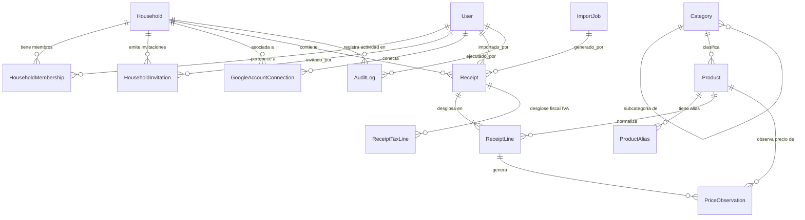

# SuperDato — 02. Modelo de Datos y Esquema de Base de Datos

## 1. Diagrama Entidad-Relación (Mermaid ERD)

---

## 2. Definición Detallada de Entidades y Columnas

Todas las tablas incluyen claves primarias UUID v4 para prevenir enumeraciones predecibles y marcas de tiempo `created_at` y `updated_at` en UTC (`TIMESTAMPTZ`).

### 2.1 Dominio: Usuarios y Casas

#### `users`
Almacena las cuentas de usuario de la plataforma.

| Campo | Tipo SQL | Restricciones | Descripción |
| :--- | :--- | :--- | :--- |
| `id` | `UUID` | `PRIMARY KEY, DEFAULT gen_random_uuid()` | Identificador único del usuario. |
| `email` | `VARCHAR(255)` | `NOT NULL, UNIQUE, INDEX` | Correo electrónico principal del usuario. |
| `hashed_password` | `VARCHAR(255)` | `NOT NULL` | Hash de contraseña con Argon2id. |
| `full_name` | `VARCHAR(150)` | `NOT NULL` | Nombre para mostrar. |
| `is_active` | `BOOLEAN` | `NOT NULL, DEFAULT TRUE` | Estado de la cuenta. |
| `is_verified` | `BOOLEAN` | `NOT NULL, DEFAULT FALSE` | Email verificado. |
| `failed_login_attempts` | `INTEGER` | `NOT NULL, DEFAULT 0` | Contador para bloqueo temporal. |
| `locked_until` | `TIMESTAMPTZ` | `NULL` | Timestamp de expiración de bloqueo. |
| `created_at` | `TIMESTAMPTZ` | `NOT NULL, DEFAULT NOW()` | Fecha de registro. |
| `updated_at` | `TIMESTAMPTZ` | `NOT NULL, DEFAULT NOW()` | Última actualización de datos. |

#### `households`
Entidad central multi-tenant que agrupa las compras de un hogar.

| Campo | Tipo SQL | Restricciones | Descripción |
| :--- | :--- | :--- | :--- |
| `id` | `UUID` | `PRIMARY KEY, DEFAULT gen_random_uuid()` | Identificador de la casa. |
| `name` | `VARCHAR(100)` | `NOT NULL` | Nombre del hogar (ej. "Casa Familia Pérez"). |
| `currency` | `VARCHAR(3)` | `NOT NULL, DEFAULT 'EUR'` | Moneda estándar ISO 4217. |
| `created_by_user_id` | `UUID` | `NOT NULL, FK -> users(id)` | Usuario creador original. |
| `created_at` | `TIMESTAMPTZ` | `NOT NULL, DEFAULT NOW()` | Fecha de creación. |
| `updated_at` | `TIMESTAMPTZ` | `NOT NULL, DEFAULT NOW()` | Última actualización. |

#### `household_memberships`
Relación muchos a muchos entre usuarios y casas con asignación de rol y permisos.

| Campo | Tipo SQL | Restricciones | Descripción |
| :--- | :--- | :--- | :--- |
| `id` | `UUID` | `PRIMARY KEY, DEFAULT gen_random_uuid()` | Identificador de la membresía. |
| `household_id` | `UUID` | `NOT NULL, FK -> households(id) ON DELETE CASCADE` | Casa de pertenencia. |
| `user_id` | `UUID` | `NOT NULL, FK -> users(id) ON DELETE CASCADE` | Usuario miembro. |
| `role` | `VARCHAR(20)` | `NOT NULL, CHECK (role IN ('OWNER', 'ADMIN', 'MEMBER'))` | Rol del usuario en la casa. |
| `custom_permissions` | `JSONB` | `NOT NULL, DEFAULT '{}'` | Flags granulares de permisos si se personalizan. |
| `joined_at` | `TIMESTAMPTZ` | `NOT NULL, DEFAULT NOW()` | Fecha de ingreso en la casa. |

*Restricción única:* `UNIQUE(household_id, user_id)` (Un usuario solo tiene una membresía por casa).

#### `household_invitations`
Invitaciones pendientes para unirse a un hogar.

| Campo | Tipo SQL | Restricciones | Descripción |
| :--- | :--- | :--- | :--- |
| `id` | `UUID` | `PRIMARY KEY, DEFAULT gen_random_uuid()` | Identificador de la invitación. |
| `household_id` | `UUID` | `NOT NULL, FK -> households(id) ON DELETE CASCADE` | Casa a la que se invita. |
| `invited_email` | `VARCHAR(255)` | `NOT NULL, INDEX` | Email de destino de la invitación. |
| `role` | `VARCHAR(20)` | `NOT NULL, DEFAULT 'MEMBER'` | Rol propuesto. |
| `token_hash` | `VARCHAR(255)` | `NOT NULL, UNIQUE` | Hash seguro del token de invitación. |
| `status` | `VARCHAR(20)` | `NOT NULL, DEFAULT 'PENDING'` | `PENDING`, `ACCEPTED`, `REVOKED`, `EXPIRED`. |
| `invited_by_user_id` | `UUID` | `NOT NULL, FK -> users(id)` | Usuario que envió la invitación. |
| `expires_at` | `TIMESTAMPTZ` | `NOT NULL` | Fecha límite de aceptación (7 días típicamente). |
| `created_at` | `TIMESTAMPTZ` | `NOT NULL, DEFAULT NOW()` | Creación de la invitación. |

---

### 2.2 Dominio: Integraciones y Fuentes de Importación

#### `google_account_connections`
Conexiones OAuth 2.0 a cuentas de Google/Gmail vinculadas por los usuarios.

| Campo | Tipo SQL | Restricciones | Descripción |
| :--- | :--- | :--- | :--- |
| `id` | `UUID` | `PRIMARY KEY, DEFAULT gen_random_uuid()` | Identificador de la conexión. |
| `user_id` | `UUID` | `NOT NULL, FK -> users(id) ON DELETE CASCADE` | Usuario propietario de la cuenta de Google. |
| `household_id` | `UUID` | `NOT NULL, FK -> households(id) ON DELETE CASCADE` | Casa a la que se asocian las compras por defecto. |
| `google_email` | `VARCHAR(255)` | `NOT NULL` | Correo de Gmail conectado. |
| `encrypted_tokens` | `TEXT` | `NOT NULL` | Payload cifrado con AES-256-GCM (`access_token`, `refresh_token`, `token_expiry`). |
| `scopes` | `TEXT[]` | `NOT NULL` | Lista de permisos autorizados por Google. |
| `initial_sync_date` | `DATE` | `NOT NULL` | Fecha más antigua desde la que importar tickets. |
| `last_sync_at` | `TIMESTAMPTZ` | `NULL` | Marca de tiempo del último escaneo exitoso. |
| `last_history_id` | `VARCHAR(64)` | `NULL` | Puntero incremental de la API de Gmail. |
| `sync_status` | `VARCHAR(30)` | `NOT NULL, DEFAULT 'IDLE'` | `IDLE`, `SYNCING`, `ERROR`, `NEEDS_REAUTH`. |
| `last_error` | `TEXT` | `NULL` | Mensaje descriptivo de error en caso de fallo. |
| `created_at` | `TIMESTAMPTZ` | `NOT NULL, DEFAULT NOW()` | Creación. |
| `updated_at` | `TIMESTAMPTZ` | `NOT NULL, DEFAULT NOW()` | Última actualización. |

*Restricción única:* `UNIQUE(user_id, google_email)`.

#### `import_jobs`
Registro de ejecuciones de importación (tanto de tareas automáticas de Gmail como de cargas manuales masivas).

| Campo | Tipo SQL | Restricciones | Descripción |
| :--- | :--- | :--- | :--- |
| `id` | `UUID` | `PRIMARY KEY, DEFAULT gen_random_uuid()` | Identificador de la ejecución. |
| `household_id` | `UUID` | `NOT NULL, FK -> households(id)` | Casa afectada. |
| `connection_id` | `UUID` | `NULL, FK -> google_account_connections(id)` | Conexión origen si proviene de Gmail. |
| `source_type` | `VARCHAR(30)` | `NOT NULL` | `GMAIL_PERIODIC`, `GMAIL_MANUAL`, `PDF_UPLOAD`. |
| `status` | `VARCHAR(30)` | `NOT NULL, DEFAULT 'PENDING'` | `PENDING`, `PROCESSING`, `COMPLETED`, `FAILED`. |
| `messages_found` | `INTEGER` | `NOT NULL, DEFAULT 0` | Emails o archivos localizados. |
| `receipts_imported`| `INTEGER` | `NOT NULL, DEFAULT 0` | Tickets creados exitosamente. |
| `receipts_skipped` | `INTEGER` | `NOT NULL, DEFAULT 0` | Tickets descartados (duplicados ya existentes). |
| `errors_count` | `INTEGER` | `NOT NULL, DEFAULT 0` | Errores encontrados durante la extracción. |
| `error_details` | `JSONB` | `NOT NULL, DEFAULT '[]'` | Lista de mensajes de error estructurados. |
| `started_at` | `TIMESTAMPTZ` | `NULL` | Inicio de ejecución. |
| `completed_at` | `TIMESTAMPTZ` | `NULL` | Fin de ejecución. |

---

### 2.3 Dominio: Tickets e Impuestos

#### `receipts`
Representa una compra única realizada en un supermercado (Mercadona).

| Campo | Tipo SQL | Restricciones | Descripción |
| :--- | :--- | :--- | :--- |
| `id` | `UUID` | `PRIMARY KEY, DEFAULT gen_random_uuid()` | Identificador interno único del ticket. |
| `household_id` | `UUID` | `NOT NULL, FK -> households(id) ON DELETE RESTRICT, INDEX` | Casa a la que se imputa el gasto. |
| `imported_by_user_id`| `UUID` | `NOT NULL, FK -> users(id)` | Usuario que realizó o disparó la importación. |
| `import_job_id` | `UUID` | `NULL, FK -> import_jobs(id)` | Trabajo de importación que lo descubrió. |
| `source_type` | `VARCHAR(30)` | `NOT NULL` | `GMAIL` o `UPLOAD_MANUAL`. |
| `source_message_id` | `VARCHAR(255)` | `NULL` | ID del mensaje en Gmail (`gmail_message_id`). |
| `source_attachment_id`| `VARCHAR(255)` | `NULL` | ID del archivo adjunto en Gmail. |
| `company_name` | `VARCHAR(100)` | `NOT NULL, DEFAULT 'MERCADONA, S.A.'` | Razón social del comercio. |
| `company_cif` | `VARCHAR(20)` | `NOT NULL, DEFAULT 'A-46103834'` | CIF/NIF del establecimiento. |
| `store_address` | `VARCHAR(255)` | `NULL` | Dirección física de la tienda. |
| `store_postal_code`| `VARCHAR(10)` | `NULL` | Código postal de la tienda. |
| `store_city` | `VARCHAR(100)` | `NULL` | Localidad de la tienda. |
| `store_phone` | `VARCHAR(30)` | `NULL` | Teléfono de contacto de la tienda. |
| `invoice_number` | `VARCHAR(50)` | `NOT NULL, INDEX` | Código de factura simplificada (ej: `4534-015-538315`). |
| `store_code` | `VARCHAR(20)` | `NULL` | Código de tienda (primer segmento, ej: `4534`). |
| `pos_register` | `VARCHAR(20)` | `NULL` | Caja / TPV (segundo segmento, ej: `015`). |
| `operator_id` | `VARCHAR(30)` | `NULL` | Identificador de cajero/operador (ej: `1289387`). |
| `purchase_datetime`| `TIMESTAMPTZ` | `NOT NULL, INDEX` | Fecha y hora local de la compra convertida a UTC. |
| `purchase_date` | `DATE` | `NOT NULL, INDEX` | Fecha en calendario local de la tienda. |
| `total_amount` | `NUMERIC(10, 2)`| `NOT NULL` | Importe total liquidado en euros (€). |
| `payment_method` | `VARCHAR(50)` | `NULL` | `TARJETA BANCARIA`, `EFECTIVO`, etc. |
| `card_last_four` | `VARCHAR(4)` | `NULL` | Últimos 4 dígitos de la tarjeta (ej. `9008`). |
| `deduplication_hash`| `VARCHAR(64)` | `NOT NULL, UNIQUE` | Hash SHA-256 (`company_cif + invoice_number + purchase_datetime + total_amount`). |
| `status` | `VARCHAR(30)` | `NOT NULL, DEFAULT 'PROCESSED'` | `PENDING`, `PROCESSED`, `REVISION_NEEDED`, `ERROR`. |
| `extraction_warnings`| `JSONB` | `NOT NULL, DEFAULT '[]'` | Alertas sobre líneas dudosas o discrepancia de centavos. |
| `raw_text` | `TEXT` | `NULL` | Texto bruto extraído del PDF para depuración y reparseo. |
| `is_manual_override`| `BOOLEAN` | `NOT NULL, DEFAULT FALSE` | Flag que indica si un usuario corrigió campos a mano. |
| `created_at` | `TIMESTAMPTZ` | `NOT NULL, DEFAULT NOW()` | Fecha de importación en el sistema. |
| `updated_at` | `TIMESTAMPTZ` | `NOT NULL, DEFAULT NOW()` | Última modificación. |

#### `receipt_tax_lines`
Desglose del impuesto indirecto (IVA) detallado en el ticket.

| Campo | Tipo SQL | Restricciones | Descripción |
| :--- | :--- | :--- | :--- |
| `id` | `UUID` | `PRIMARY KEY, DEFAULT gen_random_uuid()` | Identificador de la línea fiscal. |
| `receipt_id` | `UUID` | `NOT NULL, FK -> receipts(id) ON DELETE CASCADE, INDEX` | Ticket correspondiente. |
| `tax_rate_percent` | `NUMERIC(5, 2)`| `NOT NULL` | Tipo impositivo de IVA (4.00, 10.00, 21.00). |
| `taxable_base` | `NUMERIC(10, 2)`| `NOT NULL` | Base imponible (€). |
| `tax_amount` | `NUMERIC(10, 2)`| `NOT NULL` | Cuota de IVA soportada (€). |
| `total_with_tax` | `NUMERIC(10, 2)`| `NOT NULL` | Total bruto de la base más cuota (€). |

*Restricción de verificación:* `CHECK (ROUND(taxable_base + tax_amount, 2) = total_with_tax)`.

#### `receipt_lines`
Líneas individuales de productos o servicios adquiridos dentro del ticket.

| Campo | Tipo SQL | Restricciones | Descripción |
| :--- | :--- | :--- | :--- |
| `id` | `UUID` | `PRIMARY KEY, DEFAULT gen_random_uuid()` | Identificador único de la línea. |
| `receipt_id` | `UUID` | `NOT NULL, FK -> receipts(id) ON DELETE CASCADE, INDEX` | Ticket al que pertenece. |
| `line_order` | `INTEGER` | `NOT NULL` | Posición ordinal en el ticket (1, 2, 3...). |
| `raw_description` | `VARCHAR(255)` | `NOT NULL` | Nombre textual original tal como aparece en el ticket (ej. `DEO ROLL-ON ALOE`). |
| `product_id` | `UUID` | `NULL, FK -> products(id), INDEX` | Producto normalizado asociado en el catálogo. |
| `quantity` | `NUMERIC(10, 3)`| `NOT NULL` | Cantidad de unidades o peso (ej: `2.000` unidades, o `0.390` kg). |
| `unit_of_measure` | `VARCHAR(10)` | `NOT NULL, DEFAULT 'ud'` | Unidad: `'ud'` (unidades), `'kg'` (kilogramos), `'pack'`. |
| `unit_price` | `NUMERIC(10, 2)`| `NOT NULL` | Precio por unidad o por kilogramo (€). |
| `discount_amount` | `NUMERIC(10, 2)`| `NOT NULL, DEFAULT 0.00` | Descuento aplicado en la línea (€). |
| `line_total` | `NUMERIC(10, 2)`| `NOT NULL` | Importe total liquidado de la línea (€). |
| `is_weighed_item` | `BOOLEAN` | `NOT NULL, DEFAULT FALSE` | Flag de producto vendido a granel / peso. |
| `weight_in_kg` | `NUMERIC(10, 3)`| `NULL` | Peso extraído si es producto a granel (ej. `0.390`). |
| `validation_status` | `VARCHAR(20)` | `NOT NULL, DEFAULT 'VALID'` | `VALID`, `MANUALLY_EDITED`, `SUSPICIOUS`. |
| `raw_line_data` | `JSONB` | `NOT NULL, DEFAULT '{}'` | Metadatos brutos del extractor para auditoría. |
| `is_manual_override`| `BOOLEAN` | `NOT NULL, DEFAULT FALSE` | Protegido frente a sobreescritura automática. |

---

### 2.4 Dominio: Catálogo y Precios Históricos

#### `categories`
Jerarquía estandarizada de categorías de consumo doméstico.

| Campo | Tipo SQL | Restricciones | Descripción |
| :--- | :--- | :--- | :--- |
| `id` | `UUID` | `PRIMARY KEY, DEFAULT gen_random_uuid()` | Identificador de la categoría. |
| `parent_id` | `UUID` | `NULL, FK -> categories(id) ON DELETE SET NULL` | Categoría superior para jerarquías padre/hijo. |
| `name` | `VARCHAR(100)` | `NOT NULL` | Nombre de la categoría (ej: "Frutas y Verduras"). |
| `slug` | `VARCHAR(100)` | `NOT NULL, UNIQUE` | Identificador slug (ej: `frutas-y-verduras`). |
| `icon` | `VARCHAR(50)` | `NULL` | Nombre del icono de Lucide (ej: `apple`, `beef`). |
| `color_hex` | `VARCHAR(7)` | `NULL` | Color distintivo para gráficas (ej: `#10B981`). |
| `is_system` | `BOOLEAN` | `NOT NULL, DEFAULT TRUE` | Categorías por defecto del sistema vs personalizadas. |

#### `products`
Catálogo maestro normalizado de productos independientes del ticket puntual.

| Campo | Tipo SQL | Restricciones | Descripción |
| :--- | :--- | :--- | :--- |
| `id` | `UUID` | `PRIMARY KEY, DEFAULT gen_random_uuid()` | Identificador del producto canónico. |
| `canonical_name` | `VARCHAR(255)` | `NOT NULL, UNIQUE, INDEX` | Nombre normalizado legible (ej: "Plátano Canario Granel"). |
| `category_id` | `UUID` | `NOT NULL, FK -> categories(id), INDEX` | Categoría principal asignada. |
| `default_unit` | `VARCHAR(10)` | `NOT NULL, DEFAULT 'ud'` | Unidad de medida por defecto (`ud`, `kg`, `pack`). |
| `format_description`|`VARCHAR(100)` | `NULL` | Descripción de formato (ej: "Bandeja 500g", "Pack 6x1.5L"). |
| `created_at` | `TIMESTAMPTZ` | `NOT NULL, DEFAULT NOW()` | Creación. |
| `updated_at` | `TIMESTAMPTZ` | `NOT NULL, DEFAULT NOW()` | Modificación. |

#### `product_aliases`
Mapeo de nombres originales observados en los tickets hacia el producto normalizado del catálogo.

| Campo | Tipo SQL | Restricciones | Descripción |
| :--- | :--- | :--- | :--- |
| `id` | `UUID` | `PRIMARY KEY, DEFAULT gen_random_uuid()` | Identificador del alias. |
| `product_id` | `UUID` | `NOT NULL, FK -> products(id) ON DELETE CASCADE` | Producto normalizado de destino. |
| `raw_name_normalized`| `VARCHAR(255)`| `NOT NULL, UNIQUE, INDEX` | Nombre extraído limpio en mayúsculas (ej: `DEO ROLL-ON ALOE`). |
| `source` | `VARCHAR(30)` | `NOT NULL, DEFAULT 'MERCADONA'` | Comercio origen del patrón de texto. |
| `is_verified` | `BOOLEAN` | `NOT NULL, DEFAULT FALSE` | Si fue verificado manualmente por un usuario/admin. |

#### `price_observations`
Registro histórico e inmutable de los precios pagados en cada compra para análisis de inflación y evolución temporal.

| Campo | Tipo SQL | Restricciones | Descripción |
| :--- | :--- | :--- | :--- |
| `id` | `UUID` | `PRIMARY KEY, DEFAULT gen_random_uuid()` | Identificador de la observación. |
| `household_id` | `UUID` | `NOT NULL, FK -> households(id) ON DELETE CASCADE, INDEX`| Casa que realizó el gasto. |
| `product_id` | `UUID` | `NOT NULL, FK -> products(id) ON DELETE CASCADE, INDEX` | Producto normalizado. |
| `receipt_line_id` | `UUID` | `NOT NULL, FK -> receipt_lines(id) ON DELETE CASCADE, UNIQUE` | Línea de ticket origen (relación 1:1 inmutable). |
| `observed_at` | `TIMESTAMPTZ` | `NOT NULL, INDEX` | Momento exacto de la compra (del ticket). |
| `observed_date` | `DATE` | `NOT NULL, INDEX` | Fecha de compra. |
| `unit_price` | `NUMERIC(10, 2)`| `NOT NULL` | Precio unitario abonado (€). |
| `price_per_kg_or_l`| `NUMERIC(10, 2)`| `NULL` | Precio normalizado por kg o litro si se dispone. |
| `store_code` | `VARCHAR(20)` | `NULL` | Código de tienda para comparativas de precio geográficas. |

*Regla de inmutabilidad:* No se permite `UPDATE` sobre esta tabla; ante correcciones en la línea de ticket, la fila asociada se actualiza o recrea explícitamente mediante el servicio del dominio.

---

### 2.5 Dominio: Auditoría

#### `audit_logs`
Registro de operaciones sensibles de la plataforma.

| Campo | Tipo SQL | Restricciones | Descripción |
| :--- | :--- | :--- | :--- |
| `id` | `UUID` | `PRIMARY KEY, DEFAULT gen_random_uuid()` | Identificador del evento. |
| `household_id` | `UUID` | `NULL, FK -> households(id) ON DELETE SET NULL` | Casa relacionada si aplica. |
| `user_id` | `UUID` | `NULL, FK -> users(id) ON DELETE SET NULL` | Usuario que ejecutó la acción. |
| `action` | `VARCHAR(50)` | `NOT NULL` | Ej: `USER_LOGIN`, `TICKET_EDITED`, `MEMBER_INVITED`. |
| `entity_type` | `VARCHAR(50)` | `NOT NULL` | `RECEIPT`, `HOUSEHOLD`, `USER`, `CONNECTION`. |
| `entity_id` | `VARCHAR(50)` | `NOT NULL` | UUID del recurso afectado. |
| `changes` | `JSONB` | `NOT NULL, DEFAULT '{}'` | Diff de cambios realizados (`{antes: ..., despues: ...}`). |
| `ip_address` | `VARCHAR(45)` | `NULL` | IP origen anonimizada. |
| `user_agent` | `VARCHAR(255)` | `NULL` | Navegador o cliente HTTP. |
| `created_at` | `TIMESTAMPTZ` | `NOT NULL, DEFAULT NOW()` | Fecha y hora del evento. |

---

## 3. Estrategia de Índices y Optimización de Consultas

1. **Búsquedas de deduplicación**:
   - `UNIQUE INDEX idx_receipts_deduplication_hash ON receipts(deduplication_hash)`
2. **Consultas agregadas del Dashboard**:
   - `INDEX idx_receipts_household_date ON receipts(household_id, purchase_date DESC)`
   - `INDEX idx_price_observations_product_date ON price_observations(product_id, observed_date ASC)`
3. **Búsqueda textual de productos en el catálogo**:
   - `CREATE INDEX idx_products_canonical_name_trgm ON products USING gin (canonical_name gin_trgm_ops)` (extensión `pg_trgm` para autocompletado y búsqueda difusa).
4. **Filtrado de líneas por categoría**:
   - `INDEX idx_receipt_lines_product ON receipt_lines(product_id)`

