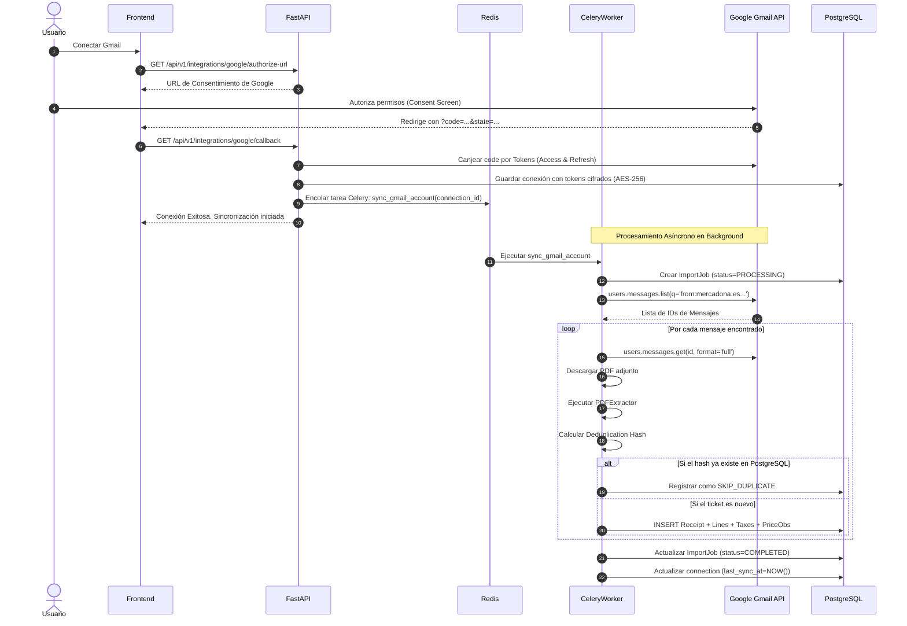

# SuperDato — 03. Integración con Gmail y Extractor de Tickets

## 1. Análisis del Formato Real de los Tickets de Mercadona

A partir de la inspección directa de tickets digitales reales en formato PDF generados por los terminales punto de venta (TPV) de Mercadona (ejemplares analizados: `samples/20261015 Mercadona 51,73 €.pdf` y `samples/20261016 Mercadona 42,57 €.pdf`), se ha obtenido la especificación exacta de la estructura textual sin necesidad de OCR.

Los documentos son PDFs generados digitalmente (texto vectorial nativo), lo que permite una extracción 100% determinista, rápida y sin pérdida de caracteres mediante bibliotecas como `pypdf` o `pdfplumber`.

```
+-------------------------------------------------------------+
| MERCADONA, S.A.   A-46103834                                |
| CL PADRE VENANCIO HUARTE                                    |
| 50007 ZARAGOZA                                              |
| TELÉFONO: 876007545                                         |
| 15/10/2026 15:43  OP: 1289387                               |
| FACTURA SIMPLIFICADA: 4534-015-538315                       |
|                                                             |
| Cnt. Descripción P. Unit Importe                            |
| 1 PIPA GIGANTE AGUASAL 1,10                                 |
| 2 DEO ROLL-ON ALOE 0,90 1,80                                |
| 1 CIRUELA AMARILLA                                          |
|   0,390 kg 3,00 €/kg 1,17                                   |
| 1 PARKING 0,00                                              |
|   ENTRADA  15:30       SALIDA  15:42                        |
|                                                             |
| TOTAL (€) 51,73                                             |
| TARJETA BANCARIA 51,73                                      |
|                                                             |
| IVA BASE IMP. (€) CUOTA (€) TOTAL (€)                       |
| 4% 18,26 0,73 18,99                                         |
| 10% 22,95 2,29 25,24                                        |
| 21% 6,20 1,30 7,50                                          |
| TOTAL 47,41 4,32 51,73                                      |
+-------------------------------------------------------------+
```

---

## 2. Gramática del Extractor (State Machine)

El módulo extractor procesa el flujo de líneas del PDF mediante una máquina de estados determinista:

### 2.1 Cabecera y Metadatos del Comercio
- **Razón Social y CIF**: Línea 1: `MERCADONA, S.A.   A-46103834`
  - Patrón: `^MERCADONA,\s*S\.A\.\s+([A-Z]-\d{8})`
- **Ubicación y Teléfono**: Dirección y código postal/localidad delimitados antes de `TELÉFONO: (\d+)`.
- **Fecha, Hora y Operador**:
  - Ejemplo: `15/10/2026 15:43  OP: 1289387`
  - Patrón: `(?P<date>\d{2}/\d{2}/\d{4})\s+(?P<time>\d{2}:\d{2})\s+OP:\s*(?P<op>\d+)`
- **Número de Factura Simplificada**:
  - Ejemplo: `FACTURA SIMPLIFICADA: 4534-015-538315`
  - Patrón: `FACTURA SIMPLIFICADA:\s*(?P<store>\d{4})-(?P<pos>\d{3})-(?P<seq>\d{6})`
  - *Identificador único compuesto*: Tienda (`4534`) + Caja/TPV (`015`) + Número de Operación (`538315`).

### 2.2 Clasificación de Tipos de Línea de Producto

El extractor itera a partir de la cabecera de columnas `Cnt. Descripción P. Unit Importe`:

#### Tipo A: Producto Estándar de 1 Unidad
- Ejemplo: `1 PIPA GIGANTE AGUASAL 1,10`
- Formato: `(?P<cnt>\d+)\s+(?P<desc>.+?)\s+(?P<total>\d+,\d{2})`
- Interpretación: Cantidad = 1, Precio Unitario = 1.10, Total Línea = 1.10.

#### Tipo B: Producto Estándar de Múltiples Unidades
- Ejemplo: `2 DEO ROLL-ON ALOE 0,90 1,80`
- Formato: `(?P<cnt>\d+)\s+(?P<desc>.+?)\s+(?P<unit_price>\d+,\d{2})\s+(?P<total>\d+,\d{2})`
- Interpretación: Cantidad = 2, Precio Unitario = 0.90, Total Línea = 1.80.

#### Tipo C: Producto Vendido por Peso / Granel (Multi-línea)
- Ejemplo:
  ```
  1 CIRUELA AMARILLA
  0,390 kg 3,00 €/kg 1,17
  ```
- Formato:
  - Línea 1 (Nombre): `1 (?P<desc>.+)`
  - Línea 2 (Medición): `(?P<weight>\d+,\d{3})\s*kg\s+(?P<price_kg>\d+,\d{2})\s*€/kg\s+(?P<total>\d+,\d{2})`
- Interpretación: Cantidad = 0.390, Unidad = `kg`, Precio/kg = 3.00, Total Línea = 1.17.
- Verificación: `0.390 * 3.00 = 1.17 €`.

#### Tipo D: Servicios Especiales / Parking
- Ejemplo:
  ```
  1 PARKING 0,00
  ENTRADA  15:30       SALIDA  15:42
  ```
- Interpretación: Se almacena como línea con importe 0.00 y metadatos complementarios en `raw_line_data`.

#### Tipo E: Descuentos y Devoluciones
- Ejemplo: `1 DESCUENTO CUPÓN -1,50` o devoluciones con importe negativo.
- Interpretación: Importe computado con signo negativo, verificado en la reconciliación del total.

---

### 2.3 Desglose Fiscal de IVA
Se extrae la tabla resumen de IVA ubicada tras la línea de `TOTAL (€)`:
```
IVA BASE IMP. (€) CUOTA (€) TOTAL (€)
4% 18,26 0,73 18,99
10% 22,95 2,29 25,24
21% 6,20 1,30 7,50
TOTAL 47,41 4,32 51,73
```
- Se generan registros independientes en `receipt_tax_lines` para cada tipo de gravamen (4%, 10%, 21%).
- Permite saber con precisión qué parte de la cesta de la compra correspondió a alimentos de primera necesidad (superreducido 4%), alimentos estándar (10%) o droguería/limpieza (general 21%).

---

### 2.4 Algoritmo de Validación y Reconciliación Contable

Cada ticket procesado debe cumplir de forma estricta las siguientes ecuaciones de balance antes de marcarse como `PROCESSED`:

$$\sum \text{line\_total} = \text{TOTAL\_TICKET} \pm 0.01$$

$$\sum \text{taxable\_base} + \sum \text{tax\_amount} = \text{TOTAL\_TICKET} \pm 0.01$$

$$\sum \text{total\_with\_tax} = \text{TOTAL\_TICKET} \pm 0.01$$

- Si la diferencia es cero: El ticket pasa a estado `PROCESSED` de forma totalmente automática.
- Si existe una diferencia superior a 1 céntimo (por ejemplo, por una línea omitida o truncada): El ticket se persiste en base de datos con estado `REVISION_NEEDED`, anotando un `extraction_warning` y encolando una alerta visual en la interfaz del usuario.

---

## 3. Integración con Google Gmail API (OAuth 2.0)

### 3.1 Alcances (Scopes) y Políticas de Google

La API de Gmail clasifica los permisos de lectura de correo como **Restricted Scopes** (Ámbitos Restringidos):

| Scope | Categoría Google | Implicaciones de Publicación |
| :--- | :--- | :--- |
| `https://www.googleapis.com/auth/gmail.readonly` | **Restricted** | Permite leer mensajes y adjuntos. Requiere evaluación anual de seguridad **CASA Tier 2** (Cloud Application Security Assessment) si la app se publica en modo Producción para público general externo. |
| `https://www.googleapis.com/auth/gmail.metadata` | **Sensitive** | Permite leer cabeceras (remitente, asunto) pero NO el cuerpo ni adjuntos (insuficiente para extraer el PDF del ticket). |

#### Estrategia para el MVP de SuperDato:
1. **Modo de Desarrollo / Testing de Google Cloud**:
   - La aplicación se registra en Google Cloud Console en estado **Testing**.
   - Permite vincular hasta **100 cuentas de prueba autorizadas** (los miembros de la familia y evaluadores del MVP) sin necesidad de pasar la auditoría externa de seguridad CASA.
2. **Criterio de Búsqueda Restrictivo**:
   - En lugar de descargar todo el buzón, la consulta a la API de Gmail filtra estrictamente:
   ```
   from:(tickets@mercadona.es OR no-reply@mercadona.es OR factura@mercadona.es) has:attachment filename:pdf
   ```
3. **Mecanismo de Desconexión y Revocación**:
   - Endpoint explícito `/api/v1/integrations/google/disconnect` que no solo borra las credenciales locales, sino que invoca el endpoint de revocación de Google (`https://oauth2.googleapis.com/revoke?token=...`).

---

### 3.2 Flujo de Sincronización Asíncrona (Celery + Redis)



---

## 4. Deduplicación y Huella Digital del Ticket (Fingerprint)

Para evitar duplicados cuando dos usuarios de la misma casa reciben el mismo correo, o cuando se resincroniza un periodo de tiempo histórico, se genera un **hash criptográfico unívoco**:

$$\text{Deduplication Hash} = \text{SHA256}(\text{company\_cif} + \text{"\_"} + \text{invoice\_number} + \text{"\_"} + \text{purchase\_iso\_timestamp} + \text{"\_"} + \text{total\_amount})$$

- Ejemplo con ticket real:
  - CIF: `A-46103834`
  - Factura: `4534-015-538315`
  - Fecha/Hora: `2026-10-15T15:43:00`
  - Total: `51.73`
  - Cadena: `A-46103834_4534-015-538315_2026-10-15T15:43:00_51.73`
  - Restricción en PostgreSQL: `receipts.deduplication_hash UNIQUE`.
- Si una tarea de importación detecta que el hash ya existe, marca el ticket como duplicado, incrementa el contador `receipts_skipped` y omite la inserción sin provocar fallos en el trabajo.

---

## 5. Manejo de Ambigüedad en la Asignación a Casas

Cuando un usuario pertenece a más de una casa:
1. **Regla por Defecto**: Cada conexión de Gmail se asocia a una `default_household_id` elegida por el usuario durante la vinculación.
2. **Confirmación de Asignación en Ambigüedad**:
   - Si el usuario no tiene una casa por defecto o la compra supera un umbral de sospecha, el ticket se importa en estado `PENDING_ASSIGNMENT`.
   - La interfaz muestra un aviso destacado: *"Tienes 1 ticket pendiente de imputar a un hogar"*.
   - El ticket no computa en los dashboards agregados hasta que un miembro autorizado confirma a qué casa corresponde.

