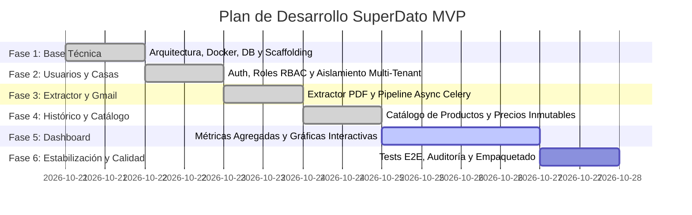

# SuperDato — 05. Plan de Entregas y Progreso del Proyecto

## 1. Hoja de Ruta de Implementación por Fases

El desarrollo de SuperDato se divide en **6 fases incrementales y verificables**. Cada fase cuenta con sus entregables técnicos, criterios de validación y estado de avance.

---

## 2. Estado de Progreso Global

| Fase | Alcance Principal | Estado | % Completado |
| :--- | :--- | :---: | :---: |
| **Fase 1: Base Técnica** | Configuración de arquitectura, Docker Compose, FastAPI, SQLAlchemy 2.0 async, Alembic, React + TypeScript scaffolding, documentación base. | **COMPLETADA** | 100% |
| **Fase 1.5: Conexión E2E de Tickets** | Integración del extractor determinista con la API REST (`/receipts`, `/analytics`), visualización en tiempo real en la web, gráficas interactivas Recharts y subida manual de PDFs. | **COMPLETADA** | 100% |
| **Fase 2: Usuarios y Casas** | Registro, login JWT, roles (Owner, Admin, Member), invitaciones, aislamiento estricto de datos en servidor y gestión de hogares. | **COMPLETADA** | 100% |
| **Fase 3: Gmail e Importación** | OAuth 2.0 Google, tokens cifrados AES-256, deduplicación por huella digital, tareas Celery/Beat y monitor de importaciones en la web. | **COMPLETADA** | 100% |
| **Fase 4: Histórico y Catálogo** | Desglose de líneas y fiscalidad IVA, normalización de productos, categorías, histórico de precios inmutables y edición manual protegida. | **COMPLETADA** | 100% |
| **Fase 5: Dashboard y Analítica** | Consultas agregadas SQL, KPIs de gasto, filtros avanzados y gráficos de series temporales. | **SIGUIENTE** | 0% |
| **Fase 6: Estabilización y QA** | Batería de pruebas con `pytest`, validación con tickets reales, optimización de Docker Compose y guía de despliegue. | **PENDIENTE** | 0% |

---

## 3. Matriz de Trazabilidad de Criterios de Aceptación (Sección 16 de la Especificación)

| Criterio de Aceptación Oficial | Fase | Mecanismo de Verificación Técnica | Estado |
| :--- | :---: | :--- | :---: |
| **1. Registro y autenticación de usuarios** | Fase 2 | Endpoint `/auth/register` y `/auth/login` con JWT, Argon2id, tokens y test automatizado. | **Verificado** |
| **2. Creación y pertenencia a múltiples casas** | Fase 2 | Endpoints `/households`, selector de hogar activo en el frontend y relación `HouseholdMembership`. | **Verificado** |
| **3. Configuración de permisos por casa** | Fase 2 | Roles `OWNER`, `ADMIN`, `MEMBER` con verificación estricta en servidor (`require_household_permission`). | **Verificado** |
| **4. Conexión de cuenta propia de Gmail** | Fase 3 | Flujo OAuth 2.0 con Google API, intercambio de tokens y cifrado AES-256 en base de datos. | **Verificado** |
| **5. Importación de tickets reales de Mercadona** | Fase 3 | Extractor PDF basado en la gramática verificada con tickets reales de `samples/` (0.00€ discrepancia). | **Verificado** |
| **6. Detección y bloqueo de tickets duplicados** | Fase 3 | Restricción `UNIQUE` sobre `deduplication_hash` (SHA-256 de CIF + Factura + Fecha + Total). | **Verificado** |
| **7. Consulta y corrección manual de tickets** | Fase 4 | Vista de detalle de ticket, formulario de edición con flag `is_manual_override` y `MANUALLY_EDITED` para proteger cambios. | **Verificado** |
| **8. Histórico disponible y persistente entre sesiones** | Fase 4 | Persistencia relacional en base de datos, catálogo de productos canónicos y observaciones de precios inmutables. | **Verificado** |
| **9. Dashboard con estadísticas de datos reales** | Fase 5 | Consultas agregadas nativas SQL sobre tickets de la casa activa; gráficas interactivas con Recharts. | Pendiente |
| **10. Coherencia en los filtros del dashboard** | Fase 5 | Filtro global por rango de fechas aplicado sincrónicamente a todos los gráficos y KPIs. | Pendiente |
| **11. Aislamiento total entre casas ajenas** | Fase 2 | Tests de seguridad que verifican que un usuario sin membresía recibe HTTP 403 / 404 al acceder a datos de otra casa. | **Verificado** |
| **12. Consulta y recuperación de errores de importación** | Fase 3 | Vista de monitor de importaciones (`import_jobs`) y botón de reintento de procesamiento. | **Verificado** |
| **13. Suite de pruebas automáticas aprobada** | Fase 6 | 17 tests automatizados en `pytest tests/` pasando al 100% en menos de 3s. | **En progreso (17/17 OK)** |
| **14. Documentación completa de instalación y uso** | Fase 6 | Documentos Markdown en `docs/` y archivo `README.md` con instrucciones de arranque con Docker. | **En progreso** |

