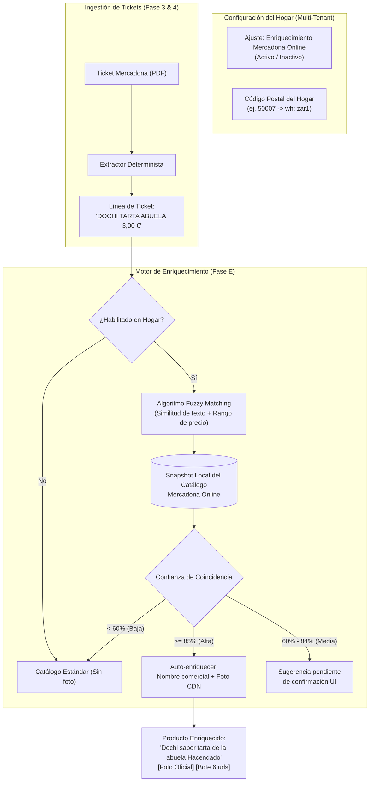
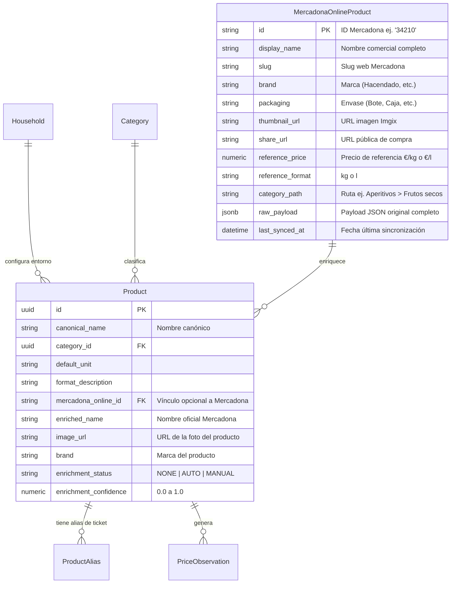
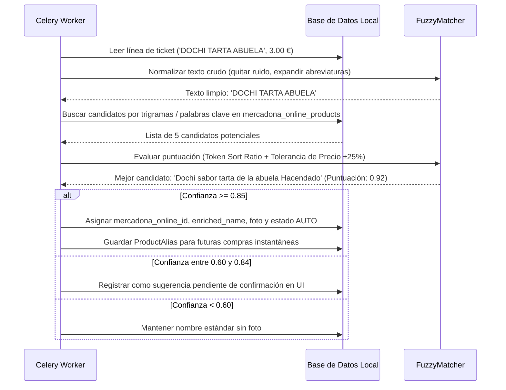

# SuperDato — 07. Diseño Técnico: Integración del Catálogo Online de Mercadona

## 1. Visión y Objetivos de la Característica

### 1.1 Contexto y Motivación
Los tickets de compra emitidos por los terminales punto de venta (TPV) físicos de Mercadona imprimen descripciones truncadas, abreviadas y en mayúsculas (por ejemplo, `DOCHI TARTA ABUELA`, `DEO ROLL-ON ALOE`, `PIPA GIGANTE AGUASAL` o `CONTORNO OJOS PREVE`). 

Aunque el motor de normalización de SuperDato ya agrupa estos productos y asigna categorías por reglas heurísticas, integrar la información pública de la plataforma de comercio electrónico de Mercadona (`tienda.mercadona.es`) permite elevar radicalmente la experiencia de usuario:
- **Nombres comerciales legibles**: Sustituir abreviaturas crípticas por su denominación oficial (ej. *"Dochi con sabor a tarta de la abuela Hacendado"*).
- **Fotografías oficiales de alta calidad**: Mostrar miniaturas e imágenes alojadas en la red de distribución de contenidos (CDN) oficial de Mercadona (`prod-mercadona.imgix.net`).
- **Formato, envase y marca**: Identificar marcas propias (*Hacendado, Deliplus, Bosque Verde, Compy*) y el formato comercial exacto (*Bote 150 g, Paquete 6 uds, Bandeja 400 g*).
- **Enlace web directo**: Permitir abrir con un clic la ficha del producto en `tienda.mercadona.es`.

### 1.2 Principio de Activación Opcional por Hogar
Esta funcionalidad se diseña como un **módulo adicional opt-in**:
- Cada hogar puede **activarla o desactivarla** de forma independiente desde `Ajustes del Hogar`.
- Permite configurar el **Código Postal del hogar** para asociar los productos al almacén logístico o centro de distribución (*colmena*) más cercano.
- Si está desactivada, SuperDato opera con el modo estándar de tickets sin realizar ninguna llamada externa ni mostrar miniaturas de la web.



---

## 2. Investigación Técnica de la API de Mercadona (`tienda.mercadona.es/api`)

A partir de la ingeniería inversa documentada en repositorios de la comunidad (`datania/mercadona-catalog`, `ablancodev`, `supermercapy`, `mercaapi`), se resumen los detalles técnicos de la API web interna de Mercadona:

### 2.1 Puntos de Entrada (Endpoints) Clave

| Método | Endpoint | Parámetros Clave | Propósito | Autenticación |
| :--- | :--- | :--- | :--- | :---: |
| `GET` | `/api/categories/` | `lang=es`, `wh=<código_almacén>` | Devuelve el árbol completo de secciones, categorías y subcategorías con IDs. | Pública |
| `GET` | `/api/categories/{id}/` | `lang=es`, `wh=<código_almacén>` | Devuelve todos los productos pertenecientes a una categoría concreta. | Pública |
| `GET` | `/api/products/{id}/` | `lang=es`, `wh=<código_almacén>` | Ficha detallada de un producto específico (ingredientes, alérgenos, fotos). | Pública |
| `GET` | `/api/home/` | `lang=es`, `wh=<código_almacén>` | Estructura general de portada y secciones destacadas. | Pública |

### 2.2 Estructura JSON de Respuesta de Producto
Ejemplo real del esquema de un producto devuelto por `/api/categories/{id}/` o `/api/products/{id}/`:

```json
{
  "id": "34210",
  "slug": "pinones-ibericos-hacendado-bote",
  "display_name": "Piñones ibéricos Hacendado",
  "packaging": "Bote",
  "share_url": "https://tienda.mercadona.es/product/34210/pinones-ibericos-hacendado-bote",
  "thumbnail": "https://prod-mercadona.imgix.net/images/ddb724e60f464fe38d24cbca3c90adb8.jpg?fit=crop&h=300&w=300",
  "photos": [
    {
      "zoom": "https://prod-mercadona.imgix.net/images/ddb724e60f464fe38d24cbca3c90adb8.jpg?fit=fillmax&h=1600&mtop=0&w=1600",
      "regular": "https://prod-mercadona.imgix.net/images/ddb724e60f464fe38d24cbca3c90adb8.jpg?fit=fillmax&h=600&mtop=0&w=600",
      "thumbnail": "https://prod-mercadona.imgix.net/images/ddb724e60f464fe38d24cbca3c90adb8.jpg?fit=crop&h=300&w=300",
      "perspective": 1
    }
  ],
  "price_instructions": {
    "iva": 10,
    "is_new": false,
    "unit_price": "2.40",
    "unit_size": 0.15,
    "bulk_price": "16.00",
    "reference_price": "16.000",
    "reference_format": "kg",
    "total_units": 1
  },
  "categories": [
    {
      "id": 112,
      "name": "Aperitivos",
      "level": 1,
      "order": 12
    },
    {
      "id": 113,
      "name": "Frutos secos y fruta desecada",
      "level": 2,
      "order": 1
    }
  ]
}
```

### 2.3 CDN de Imágenes (`prod-mercadona.imgix.net`)
Las imágenes de producto se sirven a través del servicio Imgix. Admiten parámetros dinámicos de recorte y optimización sin requerir autenticación:
- Miniaturas para listas y tablas: `?fit=crop&h=80&w=80&q=75`
- Tarjetas medianas de catálogo: `?fit=crop&h=300&w=300&q=80`
- Zoom en modal de detalle: `?fit=fillmax&h=800&w=800`

### 2.4 Requisito de Código Postal y Almacén (`wh`)
Mercadona asigna catálogo, stock y precios locales en base a códigos de almacén (`wh`, ej. `vlc1`, `mad1`, `bcn1`, `zar1`). 
- Al registrar un código postal en SuperDato (ej. `50007`), el sistema resuelve el almacén logístico de referencia y lo almacena en la configuración del hogar para asegurar que los precios coincidan con su tienda habitual.

---

## 3. Riesgos Técnicos y Decisión Arquitectónica Fundamental

### 3.1 Riesgos Identificados
1. **API no documentada ni con SLA público**: Mercadona puede modificar rutas, requerir encabezados específicos (`x-version`, `x-customer-device-id`) o variar la estructura de datos.
2. **Limitación de tasa (Rate Limiting) y Bloqueo IP**: Peticiones en tiempo real por cada ticket importado podrían provocar respuestas `429 Too Many Requests` o bloqueos temporales.
3. **Discrepancia léxica entre TPV y Web**: Los tickets físicos de caja no incluyen código de barras EAN ni ID web de Mercadona; solo imprimen la descripción corta abreviada.

### 3.2 Decisión Arquitectónica: Snapshot Local con Celery
Para blindar a SuperDato contra estos riesgos:
1. **Zero llamadas a Mercadona en peticiones de usuario**: El backend de SuperDato **nunca** consultará a Mercadona en tiempo real durante la navegación o importación de un ticket.
2. **Snapshot Local Periódico**: Un worker de Celery sincronizará el catálogo completo de Mercadona en una tabla local (`mercadona_online_products`) de forma desatendida y periódica (por ejemplo, una vez al mes o bajo demanda).
3. **Matching Offline**: El emparejamiento entre las líneas del ticket y el catálogo online se efectúa contra la base de datos local de SuperDato mediante algoritmos en Python y consultas SQL indexadas, garantizando una respuesta en milisegundos.

---

## 4. Diseño del Modelo de Datos (Esquema Relacional)



### 4.1 Ampliación de la Configuración del Hogar (`households.settings`)
Se añade una columna `settings` de tipo `JSONB` (o `JSON` en SQLite) en la tabla `households`:

```json
{
  "mercadona_online_enrichment": {
    "enabled": true,
    "postal_code": "50007",
    "warehouse_code": "zar1",
    "auto_match_threshold": 0.85,
    "show_images_in_dashboard": true,
    "show_images_in_receipts": true
  }
}
```

### 4.2 Nueva Tabla: `mercadona_online_products`
Almacena el catálogo público extraído de la web para búsquedas ultrarrápidas locales:

| Campo | Tipo SQL | Restricciones | Descripción |
| :--- | :--- | :--- | :--- |
| `id` | `VARCHAR(50)` | `PRIMARY KEY` | Identificador del producto en Mercadona Online (ej. `"34210"`). |
| `display_name` | `VARCHAR(255)` | `NOT NULL, INDEX` | Denominación comercial completa. |
| `slug` | `VARCHAR(255)` | `NOT NULL` | Identificador en la URL web. |
| `brand` | `VARCHAR(100)` | `NULL, INDEX` | Marca (Hacendado, Deliplus, Bosque Verde, etc.). |
| `packaging` | `VARCHAR(150)` | `NULL` | Tipo de envase / presentación comercial. |
| `thumbnail_url` | `TEXT` | `NOT NULL` | URL de la imagen en CDN Imgix. |
| `share_url` | `TEXT` | `NULL` | Enlace a la ficha web oficial de Mercadona. |
| `reference_price` | `NUMERIC(10, 3)` | `NULL` | Precio unitario de referencia (€/kg o €/l). |
| `reference_format` | `VARCHAR(20)` | `NULL` | Unidad de referencia (`kg`, `l`, `ud`). |
| `category_path` | `VARCHAR(255)` | `NULL` | Migas de pan de categoría (ej. "Aperitivos > Frutos secos"). |
| `raw_payload` | `JSONB / JSON` | `NULL` | Estructura completa de respaldo de la API de Mercadona. |
| `last_synced_at` | `TIMESTAMPTZ` | `NOT NULL, DEFAULT NOW()` | Fecha y hora de captura del dato. |

### 4.3 Campos de Enriquecimiento en `products`
Se extienden los productos de SuperDato con:
- `mercadona_online_id` (`VARCHAR(50)`, FK nullable a `mercadona_online_products.id`).
- `enriched_name` (`VARCHAR(255)`, nullable): Nombre comercial enriquecido.
- `image_url` (`TEXT`, nullable): Enlace a la foto activa.
- `brand` (`VARCHAR(100)`, nullable): Marca identificada.
- `enrichment_status` (`VARCHAR(20)`, default `'NONE'`): `'NONE'`, `'AUTO'`, `'MANUALLY_CONFIRMED'`.
- `enrichment_confidence` (`NUMERIC(4, 3)`, nullable): Coeficiente de similitud calculado (ej. `0.940`).

---

## 5. Algoritmo de Emparejamiento Difuso (Fuzzy Matching Pipeline)

Dado que los tickets físicos no contienen identificadores numéricos compartidos con la web, el motor de emparejamiento ejecutará un pipeline en 4 etapas:



### 5.1 Reglas del Algoritmo
1. **Diccionario de Abreviaturas Frecuentes de Mercadona**:
   - `DEO` $\rightarrow$ `DESODORANTE`
   - `AGUASAL` $\rightarrow$ `AGUA SAL / CON SAL`
   - `PREVE` $\rightarrow$ `PREVENCION / PREVENT`
   - `PIPA` $\rightarrow$ `PIPAS`
   - `SOLOM.` $\rightarrow$ `SOLOMILLO`
2. **Cálculo de Similitud Léxica**:
   - Combinación de *Token Set Ratio* (que tolera el desorden y palabras intermedias como *Hacendado* o *de la*) y distancia de Levenshtein normalizada.
3. **Filtro de Cordura Contable (Tolerancia de Precio)**:
   - Si la línea del ticket marca un precio unitario de $3.00$ € y el candidato online cuesta $18.50$ €, la coincidencia se penaliza o descarta automáticamente, evitando asociar productos caros con nombres parecidos (ej. vino gran reserva vs vino de mesa).

---

## 6. Diseño de la Interfaz de Usuario (UI/UX)

### 6.1 Pantalla de Ajustes del Hogar (`SettingsPage`)
Se añade una tarjeta de configuración dedicada:

```
+--------------------------------------------------------------------------+
|  🛍️ Integración con Mercadona Online                     [ Activado /x/ ] |
|  Enriquece automáticamente los artículos de los tickets con fotos        |
|  oficiales, nombres comerciales y marcas del supermercado.               |
|                                                                          |
|  Código Postal del Hogar:  [ 50007       ]  Almacén asignado: Zaragoza (zar1)
|  Modo de asociación:       (x) Automático para coincidencias claras      |
|                            ( ) Solicitar confirmación siempre            |
|                                                                          |
|  [ Sincronizar catálogo ahora ]  Última actualización: hace 3 días       |
+--------------------------------------------------------------------------+
```

### 6.2 Visualización en Listado de Productos (`ProductsPage`)
- **Con fotos y nombres ricos**:
  - Las tarjetas de producto muestran la imagen oficial cargada desde `prod-mercadona.imgix.net`.
  - Aparece el nombre enriquecido oficial junto a la insignia de la marca (*Hacendado*, *Deliplus*).
  - Un botón secundario permite abrir el producto directamente en `tienda.mercadona.es`.
- **Gestión de Sugerencias**:
  - Una pestaña de "Sugerencias pendientes" muestra emparejamientos con confianza media ($60\% - 84\%$) para que el usuario pueda validarlos o descartarlos con un solo clic.

### 6.3 Visualización en Detalle de Ticket (`ReceiptDetailModal`)
- Junto a cada línea de ticket (`1 DOCHI TARTA ABUELA`), aparece una miniatura de 36x36 px con la foto del producto y un tooltip con la información enriquecida.

---

## 7. Fases de Implementación Recomendadas (Roadmap)

| Fase | Título | Entregables Técnicos |
| :---: | :--- | :--- |
| **E.1** | **Diseño y Especificación** | Documento técnico actual `07_DISENO_INTEGRACION_MERCADONA_CATALOG_ONLINE.md` aprobado. |
| **E.2** | **Modelo de Datos y Migración** | Tabla `mercadona_online_products`, campos de enriquecimiento en `products` y columna `settings` en `households`. |
| **E.3** | **Servicio de Ingestión de Catálogo** | Cliente asíncrono en Python (`MercadonaStorefrontClient`) para descargar y estructurar el catálogo sin saturar la API externa. |
| **E.4** | **Motor de Fuzzy Matching** | Algoritmo con similitud léxica, diccionario de abreviaturas y filtro de precio. |
| **E.5** | **Interfaz de Usuario y Ajustes** | Interruptor en `SettingsPage`, renderizado de imágenes en `ProductsPage` y `ReceiptDetailModal`, y vista de confirmación de sugerencias. |
| **E.6** | **Pruebas y Tareas Celery** | Tarea programada mensual en Celery Beat para refresco del catálogo y tests unitarios de matching. |

---

## 8. Conclusiones y Próximos Pasos
Esta especificación garantiza que la integración:
1. **Es 100% segura para la privacidad del usuario** (no envía datos de compra a Mercadona).
2. **Es opcional y configurable por casa** (se activa con un toggle y respeta el multi-tenant).
3. **No depende de peticiones síncronas a Mercadona**, protegiendo la velocidad y fiabilidad de SuperDato mediante un snapshot local.

> [!NOTE]
> Este documento queda registrado como especificación de diseño para la fase de mejora continua de SuperDato.
