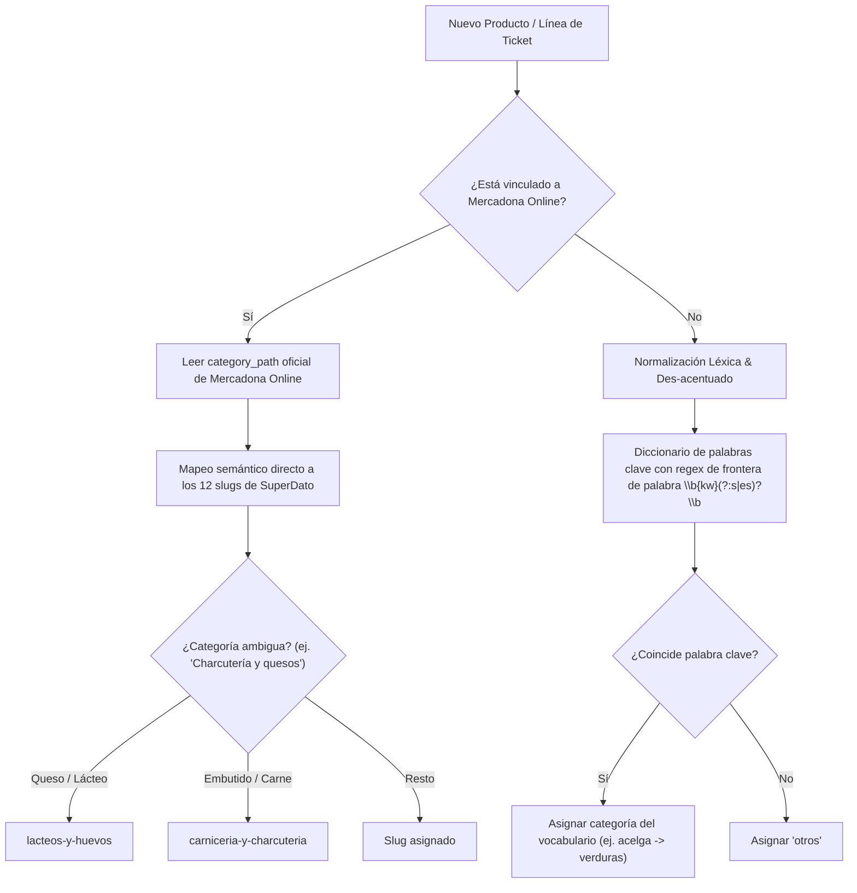

# Motor de Categorización Inteligente y Persistencia de Productos

Este documento detalla la arquitectura del motor de clasificación automática de productos de Mercadona, el flujo de edición manual por parte del usuario y las garantías de persistencia para compras históricas y futuras.

---

## 1. Problema Abordado

En los tickets originales impresos y digitales de Mercadona, las líneas de compra **no contienen metadatos de categoría** (únicamente aparece la descripción abreviada en mayúsculas, unidades, importe y tipo de IVA).
Anteriormente, al no existir una pista de categoría (`category_hint = None`), el sistema asignaba por defecto la categoría `otros`, provocando que **más del 90% de los productos y del gasto acumulado terminasen en "Otros"** (pescados, embutidos, verduras, lácteos, panadería, etc.).

---

## 2. Arquitectura de Clasificación Jerárquica

El clasificador [`classify_product`](file:///Z:/Martin/Proyectos/5.SuperDato-MercadonaTicketTracker/backend/app/domains/catalog/categorizer.py) implementa una estrategia en cascada de 3 niveles:

### Categorías Oficiales y Slugs del Sistema

| Categoría del Sistema | Slug | Ejemplos de Coincidencia (Tickets o Web) |
|---|---|---|
| **Frutas y Verduras** | `frutas-y-verduras` | Acelga, borraja, cardo, tomate, patata, cebolla, plátano, manzana, kiwi, ciruela, paraguayo, ensalada, lechuga, setas, champiñón... |
| **Carnicería y Charcutería** | `carniceria-y-charcuteria` | Jamón, chorizo, lomo, pavo, pollo, carne picada, salchichas, bacon, hamburguesa, solomillo, secreto, costilla, fuet, mortadela... |
| **Pescadería** | `pescaderia` | Pescado, merluza, salmón, rape, atún, bonito, dorada, lubina, gambas, calamar, sepia, pulpo, mejillones... |
| **Lácteos y Huevos** | `lacteos-y-huevos` | Leche, queso, gouda, mozzarella, yogur, mantequilla, kéfir, nata, huevos, cuajada, parmesano, flan... |
| **Panadería y Pastelería** | `panaderia-y-pasteleria` | Pan, barra, integral, tostadas, molde, croissant, magdalenas, galletas, rosquillas, picos, regañás, masa... |
| **Despensa y Conservas** | `despensa-y-conservas` | Arroz, pasta, fideos, lentejas, garbanzos, tomate frito, conserva, aceite, vinagre, sal, café, cacao, chocolate, mayonesa, pimentón... |
| **Bebidas y Refrescos** | `bebidas-y-refrescos` | Agua, cerveza, radler, refresco, cola, zumo, vino, sidra, tónica, ginebra, licor, Fontébil, Font Vella... |
| **Congelados** | `congelados` | Ultracongelado, helado, hielo, nuggets, croquetas, varitas, polos, sorbete... |
| **Limpieza y Hogar** | `limpieza-y-hogar` | Detergente, suavizante, lavavajillas, lejía, limpiador, friegasuelos, bolsas, papel higiénico, servilletas, bayeta, estropajo... |
| **Cuidado Personal y Perfumería** | `cuidado-personal-y-perfumeria` | Champú, gel, desodorante, dentífrico, pasta de dientes, crema, toallitas, cuchillas, colonia, pañales, jabón... |
| **Platos Preparados** | `platos-preparados` | Pizza, lasaña, tortilla, canelones, empanada, sushi, ensaladilla, gazpacho, salmorejo, Listo para comer... |
| **Mascotas** | `mascotas` | Perro, gato, compy, pienso, arena gatos, snack perro... |

---

## 3. Garantías de Persistencia para Futuras Compras

1. **Estructura Relacional Desacoplada**:
   - `receipt_lines` enlaza a `products.id` a través de clave foránea.
   - `products` almacena `category_id`, `canonical_name`, `default_unit` y enlaces de Mercadona Online.
   - `product_aliases` almacena todas las variantes textuales que aparecen en los tickets (`raw_name_normalized`, ej: `"CARDO TROCEADO"` o `"1 CARDO TROCEADO"`).

2. **Flujo de Ingestión Idempotente**:
   - Cuando entra un nuevo ticket en PDF o correo:
     1. El sistema extrae el texto de la línea: `"CARDO TROCEADO"`.
     2. Normaliza el texto a `raw_key`: `"CARDO TROCEADO"`.
     3. Busca en `product_aliases` si `raw_name_normalized == "CARDO TROCEADO"`.
     4. Al encontrar el alias, **retorna inmediatamente el producto maestro existente**, heredando de forma estricta:
        - La categoría asignada (automática o editada manualmente por el usuario).
        - El nombre canónico corregido.
        - Las imágenes, marca comercial y enlace a Mercadona Online.
        - La acumulación de precios en el histórico inmutable.

3. **Edición Manual de Categoría en la UI**:
   - En la tabla de productos (`/products`), la insignia de categoría es editable mediante un clic o a través del botón **"Categoría"** en la fila.
   - El diálogo modal permite seleccionar de forma instantánea cualquiera de las 12 categorías disponibles.
   - La llamada `PATCH /api/v1/catalog/products/{id}` persiste el cambio en la base de datos y refresca inmediatamente el catálogo, el desglose de tickets y las gráficas analíticas del Dashboard.

