# SuperDato — 11. Auditoría Integral de Seguridad, Mejoras Técnicas y Hoja de Ruta Funcional

**Fecha de Auditoría**: 24 de octubre de 2026  
**Alcance**: Backend (FastAPI / SQLAlchemy / Celery), Frontend (React 19 / TypeScript / Vite / PWA), Infraestructura (`docker-compose.yml`) y Modelo de Datos.

---

## Índice
1. [Resumen Ejecutivo](#1-resumen-ejecutivo)
2. [Auditoría de Vulnerabilidades y Seguridad](#2-auditoría-de-vulnerabilidades-y-seguridad)
3. [Mejoras Técnicas, de Rendimiento y Arquitectura](#3-mejoras-técnicas-de-rendimiento-y-arquitectura)
4. [Propuestas de Nuevas Funcionalidades (Evolución del Producto)](#4-propuestas-de-nuevas-funcionalidades-evolución-del-producto)
5. [Matriz de Priorización y Plan de Acción Recomendado](#5-matriz-de-priorización-y-plan-de-acción-recomendado)

---

## 1. Resumen Ejecutivo

Tras realizar una inspección estática y dinámica del código fuente actual de **SuperDato**, se constata que la aplicación cuenta con una base arquitectónica sólida: separación modular por dominios (`auth`, `households`, `receipts`, `catalog`, `analytics`, `shopping`, `integrations`, `admin`), uso de `Argon2id` para contraseñas, cifrado `Fernet` (AES-128-CBC + HMAC-SHA256) para tokens en reposo, controles anti-IDOR en tickets y límite de tamaño de subida de PDFs (10 MB) con verificación de cabecera mágica (`%PDF-`).

No obstante, la revisión en profundidad ha identificado **9 vulnerabilidades o debilidades de seguridad** (2 de severidad Alta, 5 de severidad Media y 2 de severidad Baja), **7 cuellos de botella técnicos y de arquitectura**, y **8 oportunidades de evolución funcional** de alto valor para los usuarios.

```mermaid
flowchart LR
    subgraph Seguridad["1. Seguridad (9 Hallazgos)"]
        S1["🔴 2 Altas (OAuth State, CORS)"]
        S2["🟠 5 Medias (Brute-force, RBAC Catálogo, JWT)"]
        S3["🟡 2 Bajas (Secrets default, Password change)"]
    end
    subgraph Tecnico["2. Rendimiento y Código (7 Mejoras)"]
        T1["⚡ Consultas N+1 en Tickets"]
        T2["🧠 Caché de Fuzzy Matching"]
        T3["📦 Code-Splitting Vite (-60% bundle)"]
        T4["🔄 Cola de Refresh Token en Axios"]
    end
    subgraph Producto["3. Nuevas Funcionalidades (8 Ideas)"]
        F1["📷 OCR de Tickets con Cámara"]
        F2["📉 Detector de Reduflación"]
        F3["🤝 División de Gastos (Splitwise)"]
        F4["🏪 Soporte Multi-Supermercado"]
    end
    Seguridad --> Tecnico --> Producto
```



---

## 2. Auditoría de Vulnerabilidades y Seguridad (Estado: ✅ 9/9 RESUELTAS Y VERIFICADAS)

Todas las vulnerabilidades identificadas han sido parcheadas y cuentan con pruebas automáticas de regresión en [`backend/tests/domains/test_security_audit_fixes.py`](file:///z:/Martin/Proyectos/5.SuperDato-MercadonaTicketTracker/backend/tests/domains/test_security_audit_fixes.py) (**37/37 tests superados**).

### ✅ [VULN-01] Severidad ALTA (RESUELTA) — Falsificación del parámetro `state` en Google OAuth 2.0 (CSRF / Account Linking Hijacking)
- **Ubicación**:
  - [`backend/app/domains/integrations/client.py`](file:///z:/Martin/Proyectos/5.SuperDato-MercadonaTicketTracker/backend/app/domains/integrations/client.py#L26-L55) (`get_authorization_url`, `decode_state`)
  - [`backend/app/domains/integrations/router.py`](file:///z:/Martin/Proyectos/5.SuperDato-MercadonaTicketTracker/backend/app/domains/integrations/router.py#L41-L65) (`google_oauth_callback`)
- **Descripción técnica**:
  Aunque la documentación del método indica *"Generates Google OAuth 2.0 consent screen URL with signed state"*, el parámetro `state` únicamente codifica en Base64 plano un JSON con `{"u": user_id, "h": household_id, "t": timestamp}` sin ninguna firma criptográfica (HMAC o JWT). Además, el endpoint `GET /api/v1/integrations/google/callback` no requiere autenticación (`Depends(get_current_user)`) ni valida que el timestamp `t` no haya expirado.
- **Impacto**:
  Un atacante que conozca el `household_id` de un hogar ajeno puede codificar en Base64 un `state` manipulado apuntando a ese `household_id`, completar el flujo con su propia cuenta de Gmail y sobrescribir la conexión `GoogleAccountConnection` de la víctima, inyectando tickets falsos en dicho hogar.
- **Solución recomendada**:
  1. Firmar el `state` con `jwt.encode({"u": user_id, "h": household_id, "type": "oauth_state"}, settings.SECRET_KEY, algorithm="HS256")` con un tiempo de expiración (`exp`) de 10 minutos.
  2. Exigir `current_user: User = Depends(get_current_user)` en el endpoint de callback y verificar que `str(current_user.id) == state["u"]` además de validar su membresía en `state["h"]`.

---

### 🔴 [VULN-02] Severidad ALTA — Configuración CORS con reflexión universal de orígenes (`allow_origin_regex`) y credenciales activas
- **Ubicación**: [`backend/app/main.py`](file:///z:/Martin/Proyectos/5.SuperDato-MercadonaTicketTracker/backend/app/main.py#L39-L46)
- **Descripción técnica**:
  El middleware CORS se configura con:
  ```python
  app.add_middleware(
      CORSMiddleware,
      allow_origins=settings.BACKEND_CORS_ORIGINS,
      allow_origin_regex=r"^https?://.*",
      allow_credentials=True,
      ...
  )
  ```
  La expresión regular `r"^https?://.*"` hace que el servidor acepte y refleje **cualquier dominio de Internet** en la cabecera `Access-Control-Allow-Origin` junto con `Access-Control-Allow-Credentials: true`, dejando sin efecto práctico la lista blanca `BACKEND_CORS_ORIGINS`.
- **Impacto**:
  Si el usuario navega por una web externa maliciosa desde su móvil o PC conectado a la misma red local, dicha web puede realizar peticiones autenticadas cross-origin contra la API local (`http://10.15.15.100:8000` o `http://localhost:8000`) y leer las respuestas JSON sin bloqueo del navegador.
- **Solución recomendada**:
  Restringir `allow_origin_regex` exclusivamente a IPs de red privada local cuando `settings.ENVIRONMENT == "development"`:
  ```python
  allow_origin_regex=r"^http://(localhost|127\.0\.0\.1|10\.\d+\.\d+\.\d+|192\.168\.\d+\.\d+)(:\d+)?$" if settings.ENVIRONMENT == "development" else None
  ```

---

### 🟠 [VULN-03] Severidad MEDIA-ALTA — Contador de intentos fallidos de Login inoperante y ausencia de Rate Limiting
- **Ubicación**: [`backend/app/domains/auth/services.py`](file:///z:/Martin/Proyectos/5.SuperDato-MercadonaTicketTracker/backend/app/domains/auth/services.py#L111-L135)
- **Descripción técnica**:
  En `AuthService.login`, cuando la verificación de contraseña falla se incrementa `user.failed_login_attempts += 1`, pero **en ningún punto se comprueba si `user.failed_login_attempts` ha superado un umbral máximo** para rechazar el login o bloquear temporalmente la cuenta. Tampoco existe limitación de tasa (*rate limiting*) por IP en `/api/v1/auth/login`, `/api/v1/auth/register` ni `/api/v1/auth/refresh`.
- **Impacto**:
  Vulnerable a ataques de fuerza bruta o *credential stuffing* automatizados contra cuentas de usuario o tokens de invitación/registro.
- **Solución recomendada**:
  1. Añadir un campo `locked_until: Optional[datetime]` en el modelo `User` (o bloquear durante 15 minutos cuando `failed_login_attempts >= 5`).
  2. Integrar `slowapi` o un limitador basado en Redis (ej. máximo 10 intentos por minuto por IP en rutas `/auth/*`).

---

### 🟠 [VULN-04] Severidad MEDIA — Exposición de observaciones de precios de otros hogares en detalle individual de producto
- **Ubicación**: [`backend/app/domains/catalog/router.py`](file:///z:/Martin/Proyectos/5.SuperDato-MercadonaTicketTracker/backend/app/domains/catalog/router.py#L134-L157) (`GET /api/v1/catalog/products/{product_id}`)
- **Descripción técnica**:
  Mientras que `GET /catalog/products` y `GET /catalog/products/{id}/price-history` filtran correctamente las observaciones de precio por `household_id`, el endpoint `get_product` hace `selectinload(Product.price_observations)` sin filtrar por hogar y pasa todas las observaciones globales a `format_product_dict`.
- **Impacto**:
  Cualquier usuario autenticado que consulte `GET /api/v1/catalog/products/{id}` recibe el `latest_price`, `latest_date`, `min_price`, `max_price` y `observations_count` calculados sobre las compras de **todos los hogares del sistema**, filtrando metadatos de fechas de compra de terceros.
- **Solución recomendada**:
  Recibir `household_id: Optional[uuid.UUID] = Query(None)` en `get_product`, validar pertenencia con `verify_household_access` y filtrar `prod.price_observations` únicamente a los hogares del usuario actual.

---

### 🟠 [VULN-05] Severidad MEDIA — Mutación del catálogo compartido y sincronización masiva sin control de rol (RBAC)
- **Ubicación**: [`backend/app/domains/catalog/router.py`](file:///z:/Martin/Proyectos/5.SuperDato-MercadonaTicketTracker/backend/app/domains/catalog/router.py#L227-L327) y [`L511-L647`](file:///z:/Martin/Proyectos/5.SuperDato-MercadonaTicketTracker/backend/app/domains/catalog/router.py#L511-L647)
- **Descripción técnica**:
  Dado que el catálogo de productos (`Product`, `ProductAlias`, `MercadonaOnlineProduct`) es global para todos los hogares:
  - Endpoints pesados como `POST /api/v1/catalog/mercadona/sync` (que realiza cientos de llamadas externas a la API de Mercadona), `POST /api/v1/catalog/mercadona/enrich` y `POST /api/v1/catalog/recategorize-all` sólo requieren `Depends(get_current_user)`.
  - Endpoints destructivos de vinculación como `POST /api/v1/catalog/mercadona/reject-match` o `PATCH /api/v1/catalog/products/{id}` pueden ser ejecutados por cualquier miembro con rol básico (`MEMBER`), afectando al nombre canónico o desvinculando fotos para todos los hogares.
- **Impacto**:
  Posibilidad de denegación de servicio (agotamiento de conexiones/bloqueo de IP frente a Mercadona) o alteración no autorizada del catálogo global por usuarios con permisos de solo lectura/miembro.
- **Solución recomendada**:
  - Proteger `/mercadona/sync` y `/recategorize-all` con `Depends(require_superuser)` o un *cooldown* de 1 hora entre sincronizaciones completas.
  - Exigir que el usuario tenga rol `OWNER` o `ADMIN` en al menos un hogar para editar productos canónicos o rechazar vinculaciones globales.

---

### 🟠 [VULN-06] Severidad MEDIA — Endpoints de simulación (`connect-mock`) activos fuera de entornos de prueba
- **Ubicación**: [`backend/app/domains/integrations/router.py`](file:///z:/Martin/Proyectos/5.SuperDato-MercadonaTicketTracker/backend/app/domains/integrations/router.py#L113-L209)
- **Descripción técnica**:
  1. El endpoint `POST /api/v1/integrations/google/connect-mock` permite crear o sobrescribir registros `GoogleAccountConnection` con tokens falsos sin verificar `settings.ENVIRONMENT`.
  2. En `POST /api/v1/integrations/sync`, si el hogar no tiene cuenta de Google conectada (`if not conn:`), en lugar de devolver un error `400 Bad Request`, crea un registro `ImportJob` simulado con `status="COMPLETED"` y `receipts_imported=2`.
- **Solución recomendada**:
  Bloquear `connect-mock` cuando `settings.ENVIRONMENT == "production"` y devolver un `HTTPException(400, "No hay ninguna cuenta de Gmail conectada a este hogar")` en `/sync`.

---

### 🟠 [VULN-07] Severidad MEDIA — Ausencia de invalidación de Refresh Tokens al cambiar contraseña o cerrar sesión
- **Ubicación**:
  - [`backend/app/core/security.py`](file:///z:/Martin/Proyectos/5.SuperDato-MercadonaTicketTracker/backend/app/core/security.py#L49-L74)
  - [`backend/app/domains/auth/services.py`](file:///z:/Martin/Proyectos/5.SuperDato-MercadonaTicketTracker/backend/app/domains/auth/services.py#L146-L191)
- **Descripción técnica**:
  Los `refresh_token` tienen una validez de 14 días y son completamente *stateless* (solo incluyen `sub`, `type`, `iat`, `exp`). Cuando un usuario cambia su contraseña o un administrador la resetea (`reset_user_password`), los `refresh_token` robados o emitidos con anterioridad siguen permitiendo obtener nuevos `access_token` durante 14 días.
- **Solución recomendada**:
  Añadir una columna `token_version: int = 1` en el modelo `User` (o usar el hash truncado de `hashed_password` como claim `pwd_sig` dentro del JWT). Al cambiar o resetear la contraseña, la firma cambia e invalida instantáneamente todos los tokens emitidos previamente sin necesidad de mantener una lista negra en Redis.

---

### 🟡 [VULN-08] Severidad BAJA-MEDIA — Secretos por defecto en configuración y exposición de puertos de BD/Redis en Docker
- **Ubicación**:
  - [`backend/app/core/config.py`](file:///z:/Martin/Proyectos/5.SuperDato-MercadonaTicketTracker/backend/app/core/config.py#L53-L60)
  - [`docker-compose.yml`](file:///z:/Martin/Proyectos/5.SuperDato-MercadonaTicketTracker/docker-compose.yml#L13-L32)
- **Descripción técnica**:
  - `SECRET_KEY` y `ENCRYPTION_MASTER_KEY` tienen valores por defecto estáticos en el código. Si se despliega con `ENVIRONMENT=production` sin sobrescribir dichas variables, la seguridad criptográfica queda comprometida.
  - En `docker-compose.yml`, los contenedores `db` (`5432:5432`) y `redis` (`6379:6379`, sin `requirepass`) publican sus puertos en todas las interfaces de red (`0.0.0.0`) del host.
- **Solución recomendada**:
  - Añadir un validador en `Settings` que lance `RuntimeError` al iniciar si `ENVIRONMENT == "production"` y `SECRET_KEY` o `ENCRYPTION_MASTER_KEY` mantienen sus valores por defecto.
  - En `docker-compose.yml`, publicar los puertos de base de datos y Redis solo en loopback local (`127.0.0.1:5432:5432` y `127.0.0.1:6379:6379`).

---

### 🟡 [VULN-09] Severidad BAJA — Cambio de contraseña en perfil sin verificar la contraseña actual
- **Ubicación**: [`backend/app/domains/auth/services.py`](file:///z:/Martin/Proyectos/5.SuperDato-MercadonaTicketTracker/backend/app/domains/auth/services.py#L183-L191) (`update_profile`)
- **Descripción técnica**:
  El endpoint `PATCH /api/v1/auth/me` permite actualizar la contraseña enviando únicamente `password` nuevo en `UserUpdate`, sin exigir ni comprobar `current_password`.
- **Solución recomendada**:
  Añadir `current_password: Optional[str] = None` en `UserUpdate` y exigir que sea válido mediante `verify_password` siempre que se solicite modificar `password`.

---

## 3. Mejoras Técnicas, de Rendimiento y Arquitectura

### ⚡ [PERF-01] Eliminación de Consultas $N+1$ en `ReceiptService.get_receipt_detail`
- **Archivo**: [`backend/app/domains/receipts/services.py`](file:///z:/Martin/Proyectos/5.SuperDato-MercadonaTicketTracker/backend/app/domains/receipts/services.py)
- **Diagnóstico**:
  Al abrir el modal de detalle de un ticket, para calcular la alerta de inflación (`price_change_pct` y `previous_unit_price`) de cada línea, el código ejecuta una consulta SQL independiente a `PriceObservation` dentro del bucle `for line in receipt.lines`. Un ticket de compra mensual con 45 artículos ejecuta **46 consultas secuenciales** a la base de datos.
- **Mejora propuesta**:
  Recopilar todos los `product_id` del ticket (`product_ids = {l.product_id for l in receipt.lines if l.product_id}`) y realizar **una única consulta** antes del bucle trayendo las observaciones previas a `receipt.purchase_datetime` para esos productos, resolviendo el precio inmediato anterior en memoria en $O(1)$.

### 🧠 [PERF-02] Optimización y Caché en el Motor de Sugerencias de Mercadona (`get_mercadona_suggestions`)
- **Archivo**: [`backend/app/domains/catalog/router.py`](file:///z:/Martin/Proyectos/5.SuperDato-MercadonaTicketTracker/backend/app/domains/catalog/router.py#L329-L394)
- **Diagnóstico**:
  Cada vez que el usuario abre la pestaña de sugerencias en el catálogo, el endpoint ejecuta `SELECT * FROM mercadona_online_products` (cargando ~4.800 objetos ORM) y ejecuta la comparación difusa de cadenas en Python contra todos los productos no enriquecidos del hogar.
- **Mejora propuesta**:
  Pre-normalizar los tokens de `MercadonaOnlineProduct` en una caché en memoria (con `functools.lru_cache` o Redis invalidado tras `/mercadona/sync`) o almacenar los 3 mejores candidatos pre-calculados durante el proceso de ingesta de tickets.

### 🐛 [BUG-01] Pérdida de datos de Presupuesto Mensual cuando el filtro de fechas del Dashboard no tiene tickets
- **Archivo**: [`backend/app/domains/analytics/services.py`](file:///z:/Martin/Proyectos/5.SuperDato-MercadonaTicketTracker/backend/app/domains/analytics/services.py#L64-L78)
- **Diagnóstico**:
  En `AnalyticsService.get_summary`, si el usuario selecciona un rango de fechas personalizado donde no hubo compras (`if not receipts:`), la función hace un `return` temprano en la línea 66 **antes** de calcular `monthly_budget`, `current_month_spend`, `budget_spent_pct` y `projected_month_spend`. Como consecuencia, la tarjeta de presupuesto mensual desaparece de la interfaz si el rango filtrado está vacío.
- **Mejora propuesta**:
  Extraer el cálculo del presupuesto mensual a un método auxiliar `_compute_household_budget(db, household_id)` e incluir sus campos también en el retorno temprano cuando `receipts` es vacío.

### 📦 [PERF-03] Code-Splitting por Rutas y Fragmentación de Vendors en Frontend (Bundle > 1 MB)
- **Archivos**: [`frontend/src/App.tsx`](file:///z:/Martin/Proyectos/5.SuperDato-MercadonaTicketTracker/frontend/src/App.tsx) y `frontend/vite.config.ts`
- **Diagnóstico**:
  El build de producción genera un único archivo JavaScript de **1.037 kB** (`dist/assets/index-*.js`), superando el umbral recomendado de 500 kB. Esto penaliza el tiempo de arranque inicial (*First Contentful Paint*) al abrir la PWA en redes móviles 4G dentro del supermercado.
- **Mejora propuesta**:
  1. Cargar las páginas con `React.lazy()` (`DashboardPage`, `ProductsPage`, `AdminDashboardPage`, `ShoppingListPage`, `ReceiptsListPage`).
  2. Configurar `build.rollupOptions.output.manualChunks` en `vite.config.ts` para separar `recharts`, `lucide-react` y `@tanstack/react-query` en chunks independientes cacheables.

### 🔄 [ARCH-01] Cola de concurrencia (Mutex) en renovación de Access Token en Axios
- **Archivo**: [`frontend/src/api/client.ts`](file:///z:/Martin/Proyectos/5.SuperDato-MercadonaTicketTracker/frontend/src/api/client.ts#L35-L66)
- **Diagnóstico**:
  Cuando el `access_token` expira (cada 30 min) y el usuario entra al Dashboard, se disparan 6 peticiones paralelas (`summary`, `category-distribution`, `spending-evolution`, `top-products`, `habits`, `receipts`). Al recibir `401 Unauthorized` simultáneamente, las 6 peticiones llaman a `POST /api/v1/auth/refresh` al mismo tiempo (condición de carrera).
- **Mejora propuesta**:
  Implementar un semáforo `isRefreshing` con una cola `failedRequestsQueue` en `client.ts` para que solo la primera respuesta `401` solicite el nuevo token y resuelva en cascada las demás peticiones en espera.

### 📴 [ARCH-02] Caché Dinámica de Assets en el Service Worker para Modo Supermercado Offline
- **Archivo**: [`frontend/public/sw.js`](file:///z:/Martin/Proyectos/5.SuperDato-MercadonaTicketTracker/frontend/public/sw.js)
- **Diagnóstico**:
  Actualmente el Service Worker sólo guarda en caché `/`, `/index.html`, `/favicon.svg` y `/manifest.webmanifest` durante el evento `install`, pero no almacena en caché los archivos `/assets/index-*.js` ni `/assets/index-*.css` cuando se descargan. Si el usuario pierde la cobertura móvil dentro de la tienda y recarga la página, la app no podrá cargar el bundle JS.
- **Mejora propuesta**:
  Actualizar el listener `fetch` en `sw.js` para clonar y guardar automáticamente en `CACHE_NAME` cualquier respuesta exitosa de recursos estáticos (`/assets/`, fuentes e iconos) bajo una estrategia *Stale-While-Revalidate* o *Network-First con persistencia en caché*.

### 🗄️ [ARCH-03] Control explícito de Auto-Seeding de Tickets de Muestra
- **Archivo**: [`backend/app/domains/analytics/services.py`](file:///z:/Martin/Proyectos/5.SuperDato-MercadonaTicketTracker/backend/app/domains/analytics/services.py#L31-L35)
- **Diagnóstico**:
  `AnalyticsService._ensure_data` invoca `ReceiptService.sync_sample_receipts_to_db(db)` automáticamente siempre que la tabla `receipts` tenga 0 filas. En producción, si un administrador limpia la base de datos, el primer acceso al dashboard volverá a inyectar los tickets de prueba de `samples/`.
- **Mejora propuesta**:
  Condicionar la carga de muestras a una bandera explícita en configuración (`settings.AUTO_SEED_SAMPLES: bool = False`).

---

## 4. Propuestas de Nuevas Funcionalidades (Evolución del Producto)

### 1. 📷 Escáner OCR / IA Multimodal de Tickets Físicos con la Cámara del Móvil
- **Problema que resuelve**: Aunque ya contamos con el asistente manual artículo por artículo, introducir un ticket físico de 40 productos a mano lleva varios minutos.
- **Propuesta**: Añadir un botón **"Escanear foto de ticket"** dentro del modal de Ticket Manual que abra la cámara del teléfono, capture la foto del ticket de papel y la envíe a un endpoint `/api/v1/receipts/scan-image` (utilizando Gemini Flash Vision o OCR local) que extraiga automáticamente las líneas y pre-rellene el formulario de Ticket Manual para que el usuario solo tenga que revisar y pulsar "Guardar".

### 2. 📉 Detector de "Reduflación" (*Shrinkflation*) y Alertas de Formato
- **Problema que resuelve**: En ocasiones los supermercados mantienen el mismo precio por envase (ej. 2,50 €), pero reducen el contenido de 500 g a 420 g.
- **Propuesta**: Analizar la evolución de `price_per_kg_or_l` y `packaging` en `PriceObservation` y `MercadonaOnlineProduct`. Si el precio unitario se mantiene constante pero el peso/volumen disminuye o el precio por kilo sube, mostrar un badge especial **`⚠️ Reduflación detectada`** en el catálogo y en el dashboard.

### 3. 🤝 División de Gastos del Hogar (*Splitwise* Integrado por Ticket y Línea)
- **Problema que resuelve**: En pisos compartidos o parejas, no todos los gastos se dividen al 50% (ej. productos de higiene personal, caprichos individuales o quién pagó en caja).
- **Propuesta**:
  - Añadir el campo `paid_by_user_id` en cada ticket (con detección automática según la tarjeta bancaria de los últimos 4 dígitos del PDF de Mercadona).
  - Permitir marcar líneas concretas de un ticket como *"Gasto individual de [Miembro]"* o *"Común"*.
  - Mostrar en la vista del Hogar una tarjeta de **Liquidación Mensual**: *"Martín ha pagado 240 € y Laura 110 € → Laura debe 65 € a Martín"*.

### 4. 💳 Asociación Automática de Tarjetas Bancarias a Miembros del Hogar
- **Problema que resuelve**: Los tickets digitales de Mercadona incluyen los últimos 4 dígitos de la tarjeta bancaria (`TARJETA BANCARIA: **** **** **** 1234`).
- **Propuesta**: Permitir que cada miembro del hogar registre los últimos 4 dígitos de su tarjeta habitual en Configuración. Al importar un ticket por PDF o Gmail, SuperDato asignará automáticamente qué miembro realizó esa compra y a qué hogar corresponde sin intervención manual.

### 5. 🏷️ Radar de Ofertas y Bajadas de Precio en tu Cesta Habitual
- **Problema que resuelve**: El usuario no sabe cuándo un producto que compra habitualmente ha bajado de precio en Mercadona.
- **Propuesta**: Al sincronizar el catálogo online (`MercadonaOnlineProduct`), cruzar los precios vigentes en la tienda con el último precio pagado por el hogar en sus 50 productos más frecuentes. Generar un widget en el Dashboard y en la Lista de la Compra: **"Bajadas de precio hoy en tus básicos"** (ej. *"Aceite de Oliva 1L ha bajado de 8,95 € a 7,65 € (-14,5%)"*).

### 6. 📊 Índice de Inflación Personalizado (IPC Familiar vs IPC Oficial)
- **Problema que resuelve**: La inflación media de todos los productos no refleja el impacto real en el bolsillo de la familia, ya que un producto que compran todas las semanas pesa mucho más que uno ocasional.
- **Propuesta**: Crear una vista o pestaña de **Inflación de tu Cesta (Índice de Laspeyres familiar)** que pondere la variación de precios de los productos según las unidades anuales consumidas por el hogar, mostrando cuántos euros extra al mes le cuesta a la familia comprar exactamente lo mismo que hace 3 o 6 meses.

### 7. 📱 Escáner de Códigos de Barras (EAN-13) para la Lista de la Compra
- **Problema que resuelve**: Cuando se termina un cartón de leche o un bote de detergente en la cocina, buscarlo escribiendo en el móvil es menos inmediato que escanear el envase antes de tirarlo al cubo de reciclaje.
- **Propuesta**: Integrar un lector de códigos de barras mediante la cámara del navegador (`BarcodeDetector` API / `html5-qrcode`) en la página de Lista de la Compra para añadir el producto al instante al escanear su código EAN.

### 8. 🏪 Arquitectura Multi-Supermercado (Lidl, Carrefour, Consum, Eroski, Aldi)
- **Problema que resuelve**: Muchas familias realizan el 70% de su compra en Mercadona pero complementan en Lidl, Carrefour o Consum.
- **Propuesta**: Refactorizar el motor `PDFReceiptExtractor` bajo un patrón *Strategy* (`ReceiptExtractorRegistry`) que detecte el CIF o cabecera del PDF/ticket y aplique el parser específico de cada cadena, permitiendo comparar el gasto por supermercado y detectar en qué cadena es más barato cada producto básico (ej. *Leche Entera: Mercadona vs Lidl*).

---

## 5. Matriz de Priorización y Plan de Acción Recomendado

| ID | Categoría | Acción / Iniciativa | Impacto | Estado | Prioridad |
| :--- | :---: | :--- | :---: | :---: | :---: |
| **VULN-01** | Seguridad | Firmar criptográficamente el `state` de Google OAuth y autenticar el callback | Crítico | **✅ Completado** | **P0 (Inmediato)** |
| **VULN-02** | Seguridad | Restringir `allow_origin_regex` en CORS a IPs locales en desarrollo | Alto | **✅ Completado** | **P0 (Inmediato)** |
| **VULN-03** | Seguridad | Activar bloqueo temporal tras 5 fallos de login (`failed_login_attempts`) | Alto | **✅ Completado** | **P0 (Inmediato)** |
| **VULN-04/05**| Seguridad | Filtrar observaciones por hogar en `get_product` y RBAC en mutaciones de catálogo | Medio | **✅ Completado** | **P1 (Corto plazo)** |
| **VULN-06/07**| Seguridad | Deshabilitar `connect-mock` en producción e invalidar JWT (`pwd_sig`) al cambiar contraseña | Medio | **✅ Completado** | **P1 (Corto plazo)** |
| **VULN-08/09**| Seguridad | Validación de secretos en producción, loopback en Docker y `current_password` en perfil | Medio | **✅ Completado** | **P1 (Corto plazo)** |
| **BUG-01** | Backend | Incluir datos de presupuesto mensual en el retorno temprano de `get_summary` | Medio | Pendiente | **P0 (Inmediato)** |
| **PERF-01** | Rendimiento | Eliminar consultas $N+1$ de `PriceObservation` en detalle de ticket | Alto | Pendiente | **P1 (Corto plazo)** |
| **PERF-03** | Frontend | Code-splitting con `React.lazy` y `manualChunks` en Vite | Medio | Pendiente | **P1 (Corto plazo)** |
| **ARCH-01/02**| Frontend / PWA | Cola de refresco de JWT en Axios y caché dinámica de assets en `sw.js` | Medio | Pendiente | **P1 (Corto plazo)** |
| **FEAT-04** | Producto | Asociación automática de tickets por últimos 4 dígitos de tarjeta bancaria | Alto | Pendiente | **P2 (Medio plazo)** |
| **FEAT-02/05**| Producto | Detector de Reduflación y Radar de Bajadas de Precio en básicos | Alto | Pendiente | **P2 (Medio plazo)** |
| **FEAT-03** | Producto | División de gastos por miembro y liquidación mensual (*Splitwise*) | Alto | Pendiente | **P2 (Medio plazo)** |
| **FEAT-01** | Producto | Escáner OCR de tickets físicos mediante cámara móvil | Muy Alto | Pendiente | **P3 (Evolutivo)** |

